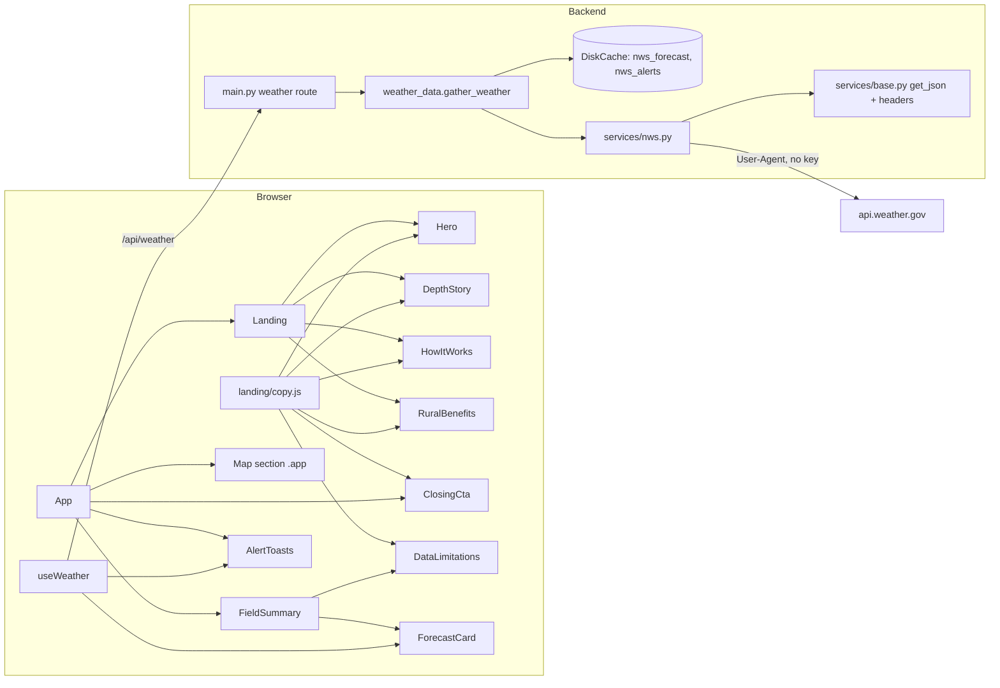

# Design Document: design-merge-weather

## Overview

This feature adds three things to the existing Field Shift app without changing what it already does:

1. A warm earth restyle (light and dark) of `frontend/src/index.css`.
2. A landing section above the map (Hero, "Below the grass line" scroll story, How it works, "Built for rural farms") and a closing call to action below the field summary. The copy and the practical fit (size, touch targets, slow connections, links to extension and NRCS help) are written for rural and small independent farmers (Requirement 14).
3. National Weather Service (NWS) data: a backend service and `GET /api/weather` route, a "Next 7 days" card and alert toasts.

Design decisions in short:

| Question | Decision | Why |
|---|---|---|
| How are the 7 days shown? | 7 day cards, each with a high and a low | See "Forecast layout" below. |
| Where does ForecastCard sit? | In `FieldSummary`, as the first section under the header, not gated on the rotation answer | The rotation answer can take about a minute; the forecast should not wait for it. This differs slightly from "after SourceStatus", which only renders once rotation data exists. |
| How do old CSS names keep working? | The old variables stay and are set from the new palette | Existing components and `ClimateChart.jsx` (which reads CSS variables from `:root`) need no rewrite. |
| Dark mode switch | Unchanged: the system `prefers-color-scheme` media query | Requirement 2.5 keeps the behaviour that exists today. |
| Alert logic | One pure function `farm_alerts(periods)` in `nws.py` | Easy to test with generated inputs. |
| Where do toasts go on the map screen? | Top right of the part of the map the data panel does not cover | A toast at the true top right would hide the data panel's header and tabs. |
| Frontend tests without new packages | Node's built-in `node --test` for pure helper modules; Playwright for the browser | The project may not add npm packages. |
| Property tests without new packages | `pytest` plus seeded `random` loops of 100+ iterations | `hypothesis` is not installed and may not be added. |

Data is US only. The tool supports farmer judgment and does not replace local expertise, so alert actions are phrased as suggestions and every alert names its source.

## Architecture



The frontend talks only to our backend. The only third-party requests from the browser stay the map tiles. Fonts and the hero photo are served from `frontend/public/` on the same origin.

## Components and Interfaces

The components and their interfaces are described in the two sections that follow.

| Component | Interface |
|---|---|
| `services/nws.py` | `fetch_periods`, `fetch_official_alerts`, `parse_periods`, `parse_official_alerts`, `farm_alerts` |
| `weather_data.py` | `gather_weather(client, lat, lon, cache, clock)` |
| `GET /api/weather` | Query `lat`, `lon`; returns `{location, source, page_url, forecast, alerts}` |
| `useWeather` | `useWeather(lat, lon)` returns `{status, data, error, retry}` |
| `ForecastCard`, `AlertToasts` | Props from the `useWeather` result; `AlertToasts` also reads the dismissed store |
| `groupDays`, `orderToasts`, `dismissedStore` | Pure helpers with the signatures shown under Frontend |

## Backend

### Files

| File | Change |
|---|---|
| `backend/app/services/base.py` | `get_json` gets an optional `headers` parameter (default `None`). |
| `backend/app/services/nws.py` | New. Constants, parsing, `farm_alerts`, and the two async fetch functions. |
| `backend/app/weather_data.py` | New. `gather_weather`: cache, concurrency, response shape. Mirrors `farm_data.py` and `rotation_data.py`. |
| `backend/app/main.py` | New route `GET /api/weather`. |
| `backend/tests/test_nws.py`, `backend/tests/fixtures/nws_*.json` | New. |
| `backend/verify.py` | New live check for `/api/weather`. |

No new pip package. `httpx`, `asyncio`, `re` and `time` are already available.

### `get_json` with headers

`get_json` cannot set request headers today. Add one optional parameter. Existing callers do not pass it, so they behave as before.

```python
async def get_json(client, url, params=None, timeout=None, headers=None):
    """... headers: extra request headers (the NWS needs a User-Agent). Default None."""
    if timeout is None:
        r = await asyncio.wait_for(client.get(url, params=params, headers=headers), UPSTREAM_TIMEOUT)
    else:
        r = await asyncio.wait_for(client.get(url, params=params, headers=headers, timeout=timeout), timeout)
    r.raise_for_status()
    return r.json()
```

### `services/nws.py`

All thresholds are named constants, each used in one place (Requirement 9.12).

```python
"""National Weather Service (api.weather.gov): forecast and active alerts. Free, no key, US only."""
import asyncio
import re

import httpx

from app.services.base import SourceUnavailable, get_json

NWS = "https://api.weather.gov"
NWS_HEADERS = {
    # The NWS asks every client to identify itself. No key is needed or sent.
    "User-Agent": "FieldShiftHackathon/1.0 (https://github.com/rowitus/Farmer-s-prototype)",
    "Accept": "application/geo+json",
}
FORECAST_TOTAL_TIMEOUT = 15.0  # /points then the forecast URL: two calls of up to 10 s each, capped here

# --- Farm alert thresholds (from the colleague's farmhelper/weather.py) ---
ALERT_WINDOW_PERIODS = 6   # first 6 twelve-hour periods, about 3 days
FROST_DANGER_F = 28        # night low at or below: "danger", Hard freeze
FROST_WARN_F = 32          # at or below: "warn", Freeze
FROST_INFO_F = 36          # at or below: "info", Frost possible
HEAT_WARN_F = 95           # day high at or above: "warn", Heat
HEAT_DANGER_F = 100        # at or above: "danger", Extreme heat
RAIN_PCT = 70              # precipitation chance at or above: rain alert
WIND_INFO_MPH = 20         # wind_max_mph at or above: "info"
WIND_WARN_MPH = 30         # at or above: "warn"
HEAVY_WORDS = re.compile(r"heavy|thunderstorm|storm", re.I)

FARM_SOURCE = "Based on NWS forecast"
OFFICIAL_SOURCE = "National Weather Service"
SEVERITY_RANK = {"danger": 0, "warn": 1, "info": 2}


class OutsideCoverage(SourceUnavailable):
    """The point is outside NWS coverage (HTTP 404 from /points). The message is farmer-readable."""


def forecast_page_url(lat: float, lon: float) -> str:
    return f"https://forecast.weather.gov/MapClick.php?lat={lat:.4f}&lon={lon:.4f}"


async def fetch_periods(client, lat, lon) -> list[dict]:
    """Forecast periods for a point. Raises OutsideCoverage on a 404 from /points."""
    async def chain():
        try:
            point = await get_json(client, f"{NWS}/points/{lat:.4f},{lon:.4f}", headers=NWS_HEADERS)
        except httpx.HTTPStatusError as e:
            if e.response.status_code == 404:  # the 404 detection lives here, not in the route
                raise OutsideCoverage("The National Weather Service only covers US locations, "
                                      "and this point is outside its coverage") from e
            raise
        data = await get_json(client, point["properties"]["forecast"], headers=NWS_HEADERS)
        return parse_periods(data)
    return await asyncio.wait_for(chain(), FORECAST_TOTAL_TIMEOUT)


async def fetch_official_alerts(client, lat, lon) -> list[dict]:
    data = await get_json(client, f"{NWS}/alerts/active",
                          params={"point": f"{lat:.4f},{lon:.4f}"}, headers=NWS_HEADERS)
    return parse_official_alerts(data)
```

Pure parsing functions, one job each:

```python
def parse_periods(data: dict) -> list[dict]:
    """NWS forecast JSON -> list of {name, start, is_day, temp_f, rain_pct, wind,
    wind_max_mph, short, detail}. temp_f is converted when the unit is C. Raises KeyError/TypeError
    on a body that is not NWS-shaped; the caller reports that as 'sent data we could not read'."""

def parse_official_alerts(data: dict) -> list[dict]:
    """alerts/active JSON -> list of {id, source, level, title, text, detail, until}.
    level is "danger" for severity extreme or severe, else "warn". until is ends, else expires."""
```

`wind_max_mph` is the largest integer found in the `windSpeed` text, or 0 when there is none ("5 to 10 mph" gives 10).

`farm_alerts(periods)` is a pure function: no I/O, no clock. It uses the first `ALERT_WINDOW_PERIODS` periods and returns at most one alert per kind, built from the most serious period of that kind, most serious level first.

```python
def farm_alerts(periods: list[dict]) -> list[dict]:
    soon = periods[:ALERT_WINDOW_PERIODS]
    out = []
    nights = [p for p in soon if not p["is_day"]]
    if nights:
        cold = min(nights, key=lambda p: p["temp_f"])
        t = cold["temp_f"]
        if t <= FROST_INFO_F:
            level, title = (("danger", "Hard freeze") if t <= FROST_DANGER_F else
                            ("warn", "Freeze") if t <= FROST_WARN_F else ("info", "Frost possible"))
            out.append(_alert("frost_freeze", cold, t, level, title, f"{cold['name']}: {t} °F", FROST_ACTIONS[level]))
    # extreme_heat: hottest day period, >= HEAT_WARN_F, "danger" at >= HEAT_DANGER_F
    # heavy_rain_storm: highest rain_pct, >= RAIN_PCT; "warn"/"Storms likely" if HEAVY_WORDS matches
    #                   short + " " + detail, else "info"/"Rain likely"
    # wind_spray: highest wind_max_mph, >= WIND_INFO_MPH "info", >= WIND_WARN_MPH "warn", title "Windy"
    return sorted(out, key=lambda a: SEVERITY_RANK[a["level"]])  # stable sort
```

`_alert(kind, period, value, level, title, reason, action)` builds `{id: f"{kind}-{start[:10]}-{value}", kind, source: FARM_SOURCE, level, title, reason, action, until: period["start"]}`. The action texts (`FROST_ACTIONS` by level, `HEAT_ACTION`, `RAIN_ACTION`, `WIND_ACTION`) are copied from the colleague's `farmhelper/weather.py`. The wind action says it is too windy to spray. The `reason` field is new compared with the colleague's code; it carries the period name and the value so the toast can show them next to the fixed title.

### `weather_data.py`: concurrency, cache, shape

```python
CACHE_TTL_S = 3600  # one hour (Requirement 10.3)

async def gather_weather(client, lat, lon, cache, clock=time.time) -> dict:
    forecast_r, alerts_r = await asyncio.gather(
        _forecast_part(client, lat, lon, cache, clock),
        _alerts_part(client, lat, lon, cache, clock),
        return_exceptions=True,        # each part fails on its own (Requirement 8.8)
    )
    ...build the response...
```

Each part is "try cache, else fetch live, write on success":

```python
def _fresh(clock):
    """is_valid for read_doc: a dict with the right shape and fetched_at less than CACHE_TTL_S old."""
    def check(doc):
        age = clock() - doc["fetched_at"]
        return 0 <= age < CACHE_TTL_S and isinstance(doc.get("periods"), list) and doc["periods"]
    return check

async def _forecast_part(client, lat, lon, cache, clock):
    hit = cache.read_doc("nws_forecast", lat, lon, _fresh(clock))
    if hit:
        return hit["periods"], "cached"
    periods = await nws.fetch_periods(client, lat, lon)
    cache.write_doc("nws_forecast", lat, lon, {"fetched_at": clock(), "periods": periods})
    return periods, "live"
```

The alerts part is the same with source `nws_alerts` and key `alerts`. An empty list of official alerts is a successful result and is cached. Exceptions are never cached: the `write_doc` call is only reached after a successful fetch. An outside-coverage result is not cached either, because the 404 is cheap to repeat.

`DiskCache` rounds the key to 2 decimals (about 1 km): `KEY_DECIMALS` in `cache.py` only lists `cdl` (4 decimals), and any other source, including `nws_forecast` and `nws_alerts`, uses the default of 2. No change to `cache.py` is needed. Nearby points therefore share a cached forecast. The forecast belongs to an NWS grid cell about 2.5 km wide, so this is a fair match. `page_url` is always built from the coordinates in the request.

Official alerts also use the 1-hour freshness from Requirement 10.3. An alert issued within the hour may appear up to an hour late; the forecast card links to the NWS page for the live view.

Building the response:

```python
{
  "location": {"lat": lat, "lon": lon},
  "source": "National Weather Service",
  "page_url": "https://forecast.weather.gov/MapClick.php?lat=..&lon=..",
  "forecast": {"status": "ok", "periods": [...], "live_or_cached": "live"}
           or {"status": "unavailable", "reason": "..."},
  "alerts":   {"status": "ok", "official": [...], "farm": [...], "live_or_cached": "live"}
           or {"status": "unavailable", "reason": "...", "official": [], "farm": [...]},
}
```

Rules for the combinations:

| Forecast | Official alerts | Result |
|---|---|---|
| ok | ok | Both ok. `farm` is `farm_alerts(periods)`. |
| unavailable | ok | Forecast unavailable with its reason. `alerts.status` is "ok", `official` filled, `farm` is `[]` because farm alerts come from the forecast. The frontend already shows the forecast reason. |
| ok | unavailable | Forecast ok. `alerts.status` is "unavailable" with a reason, `official` is `[]`, `farm` is still filled. |
| outside coverage (404) | any | Both parts unavailable with the coverage reason, whatever the alerts call returned (Requirement 8.6). |
| both fail | | Both unavailable. HTTP 200. |

Reasons come from `describe_failure("National Weather Service", exc)`. It never includes a URL or response body. `farm` alerts are computed on every response from the periods, so a change to a threshold takes effect without clearing the cache.

Logging, one line per failed part, matching `farm_data.py`:

```python
log.warning("farm_data source=nws error=%s", type(exc).__name__)
```

Nothing else is logged: no URL, no body, no coordinates.

### Route

```python
@app.get("/api/weather")
async def weather(lat: str | None = Query(None), lon: str | None = Query(None),
                  client=Depends(get_http_client), cache: DiskCache = Depends(get_cache)):
    """NWS forecast and alerts for one US location. Same validation as /api/farm-data."""
    try:
        lat_f, lon_f = check_location(lat, lon)
    except GeocodeError as e:
        raise HTTPException(status_code=400, detail=str(e))
    return await gather_weather(client, lat_f, lon_f, cache)
```

`gather_weather` catches every upstream exception through `return_exceptions=True`, and a part whose result is neither a value nor an `Exception` is reported as unavailable with "sent data we could not read". The route has no other failure path, so no upstream problem becomes a 500.

### Forecast layout: 7 day cards with a high and a low

NWS returns up to 14 twelve-hour periods. Options:

- **A. Up to 14 period rows grouped into day/night pairs.** Shows every period, but a 14-row list is long on a phone and the day/night pairing has to be explained.
- **B. 7 day cards with a high and a low.** One scannable card per calendar day.

Choice: **B**. Planning questions are per day ("can I spray Thursday?"), and 7 cards fit a 375 px single column without horizontal scroll. Nothing is lost: the card shows the larger rain chance and the larger wind of its two periods, and the day text comes from the day period (the night text is used when there is no day period). Edge cases are shown honestly: the first card can be night only ("Tonight", low only, high shown as "–"), and the last day can lack a night.

The backend keeps returning raw `periods` so the alert logic and the card use the same data. Grouping is done by a small pure frontend function `groupDays(periods)` in `frontend/src/weather/groupDays.js`. It groups by `start.slice(0, 10)` (the NWS start time carries the local date) and returns at most 7 cards `{date, name, high, low, rain_pct, wind, short}`. It invents no number: every value shown comes from a period.

## Frontend

### Files

```
frontend/
  public/
    fonts/  fraunces-600.woff2 fraunces-700.woff2 inter-400.woff2 inter-500.woff2
            inter-600.woff2 inter-700.woff2 OFL.txt
    images/ hero-field.jpg CREDITS.txt
  scripts/fetch-assets.mjs          one-time download of fonts and the photo
  src/
    index.css                       tokens, fonts, landing and weather styles
    App.jsx                         new order, skip link, toasts
    landing/  Hero.jsx DepthStory.jsx HowItWorks.jsx RuralBenefits.jsx ClosingCta.jsx ExternalLink.jsx
              SkipLink.jsx copy.js credit.js scroll.js
    fieldSummary/DataLimitations.jsx   existing file; gains the two External_Links
    weather/  useWeather.js ForecastCard.jsx AlertToasts.jsx groupDays.js toasts.js dismissedStore.js
    fieldSummary/FieldSummary.jsx   renders ForecastCard
  tests/    groupDays.test.mjs toasts.test.mjs dismissedStore.test.mjs copy.test.mjs
```

Vite already serves `frontend/public/` at the site root, so the font URL is `/fonts/inter-400.woff2` and the photo is `/images/hero-field.jpg`.

### Colour tokens and the old names

`index.css` defines the colleague's names and then maps every existing name to them, so existing components need no rewrite.

```css
:root {
  /* colleague's names (light) */
  --bg: #f3f1e9;  --card: #fffefa;  --ink: #22231f;  --muted: #6a675d;  --line: #d9d4c8;
  --green: #385943;  --green-soft: #e1e9df;  --on-green: #fffefa;  --leaf: #688752;
  --soil: #76533a;  --soil-soft: #eee3d7;  --sun: #b89556;
  --warn: #93583c;  --warn-soft: #f0e2d8;  --info: #536f5d;  --info-soft: #e3e9e1;
  --radius: 14px;

  /* the names the app uses today, now set from the palette */
  --surface: rgba(255, 254, 250, 0.92);      /* frosted panels: translucent, warm */
  --surface-solid: var(--card);               /* popovers, strategy cards, tooltips */
  --surface-sunken: rgba(34, 35, 31, 0.05);
  --text: var(--ink);
  --text-secondary: var(--muted);
  --accent: var(--green);
  --on-accent: var(--on-green);
  --accent-text: var(--green);
  --control-border: #7d7a6c;                  /* --line is too faint for a control edge */
  --divider: var(--line);
  --error: #a63a2a;
  --chart-rain: #4a7f98;
  --chart-temp: #b5532a;
}
```

Changes outside the variables, all small:

- `.summary { background: var(--bg) }` (it used `--surface-solid`, which is now the card colour).
- `.btn-primary:hover` uses a new `--accent-hover` instead of the hard-coded `#0077ed`.
- Hard-coded amber borders (`#b25e00`) and tints in `.warn-note`, `.risks` and `.soil-flag` move to `--warn` and `--warn-soft`.
- Cards get `border: 1px solid var(--line)`, `background: var(--card)`, `border-radius: var(--radius)`. Eyebrow labels (`.section-heading`) become uppercase in `--soil`. Primary buttons are green pills. Tip boxes (`.note`) and tabs (`.segmented`) take the styles of the colleague's `style.css`.
- `.frosted` is unchanged in structure: translucent `--surface`, blur, on top of the map. Only the colours change.
- The `ClimateChart.jsx` hook `useThemeColors` reads `--text-secondary`-style variables from `:root` through `getComputedStyle`, so charts follow the new values. Check at implementation that its variable list is all still defined.

### Dark palette and contrast checks

Dark mode keeps the `@media (prefers-color-scheme: dark)` block and overrides the same names.

```css
@media (prefers-color-scheme: dark) {
  :root {
    --bg: #1a1b17;  --card: #24251f;  --ink: #ece8dc;  --muted: #a8a393;  --line: #3d3c33;
    --green: #8fb59a;  --green-soft: #26332a;  --on-green: #14201a;  --leaf: #8fb06f;
    --soil: #c9a07c;  --soil-soft: #33281f;  --sun: #d2b06a;
    --warn: #e08f6c;  --warn-soft: #3a2a22;  --info: #8fb59a;  --info-soft: #263028;
    --surface: rgba(36, 37, 31, 0.94);
    --surface-sunken: rgba(236, 232, 220, 0.07);
    --control-border: #8a8676;
    --error: #f0a08a;  --chart-rain: #7fb6cc;  --chart-temp: #e49a6b;
  }
}
```

These ratios were computed with the WCAG formula while writing this design. They are to be re-measured at implementation and written into the `index.css` header comment (Requirement 2.4). The target is 4.5:1 for body text and 3:1 for control edges, icons, chart lines and focus rings.

| Pair | Light | Dark |
|---|---|---|
| ink on card | 15.7 | 12.6 |
| ink on bg | 14.0 | 14.1 |
| muted on card | 5.6 | 6.1 |
| muted on bg | 5.0 | 6.9 |
| green (links, accent text) on card | 7.8 | 6.8 |
| soil (eyebrows) on card | 6.8 | 6.5 |
| warn on card | 5.6 | 6.1 |
| info on card | 5.5 | 6.8 |
| error on card | 6.4 | 7.4 |
| on-green text on green fill (primary button) | 7.8 | 7.4 |
| control border on card (needs 3) | 4.3 | 4.2 |
| chart rain line on card (needs 3) | 4.4 | 7.0 |
| chart temperature line on card (needs 3) | 4.9 | 6.7 |
| leaf on card, graphics only (needs 3) | 4.0 | 6.3 |

Worst case behind a frosted panel (pure black map under the light panel, pure white map under the dark panel), as the current file does:

| Pair | Light, surface alpha 0.90 | Dark, surface alpha 0.94 |
|---|---|---|
| ink | 12.5 | 10.6 |
| muted (needs 4.5) | **4.49, just under** | 5.1 |
| green | 6.2 | 5.7 |
| control border (needs 3) | 3.4 | 3.5 |
| error | 5.1 | 6.2 |

Because the light muted text misses by 0.01 at alpha 0.90, the design sets the light frosted alpha to 0.92 and requires a re-measure. If it is still under 4.5, darken light `--muted` to `#625f55`. `--sun` (light 2.8) and `--line` (about 1.4) are decorative only: never used for text, icons that carry meaning, or control edges. Focus rings use `--accent` (the green), which meets 3:1 against both card and bg in both themes.

### Fonts and the hero photo

Fraunces (headings `h1` to `h3` and display numbers such as `.stat-value`, `.overall-num`) and Inter (body). `index.css` declares:

```css
@font-face { font-family: "Inter"; font-weight: 400; font-style: normal; font-display: swap;
             src: url("/fonts/inter-400.woff2") format("woff2"); }
/* ...500, 600, 700, and Fraunces 600 and 700 the same way... */
:root { --font: "Inter", -apple-system, BlinkMacSystemFont, "Segoe UI", Roboto, sans-serif;
        --font-display: "Fraunces", Georgia, "Times New Roman", serif; }
h1, h2, h3, .stat-value, .overall-num { font-family: var(--font-display); }
```

The fallback stacks keep text readable while a file loads or if it fails.

Getting the files. `frontend/scripts/fetch-assets.mjs` is a small Node script (built-in `fetch` and `fs`, no package). It runs once, by hand (`node scripts/fetch-assets.mjs`), and its output is committed by the team later. It:

1. Requests the Google Fonts CSS for `Fraunces:wght@600;700` and `Inter:wght@400;500;600;700` with a modern browser User-Agent, so the answer lists woff2 files.
2. Picks the `latin` subset URLs, downloads them to `public/fonts/`, one file per weight (two weights can resolve to the same variable file; the script still saves each name).
3. Downloads the hero photo to `public/images/hero-field.jpg` from `https://images.unsplash.com/photo-1500382017468-9049fed747ef?w=1600&q=70&fm=jpg&fit=crop`, then checks the file size against `HERO_MAX_BYTES = 300 * 1024`. If the file is larger, the script retries in this order: `w=1400&q=70`, `w=1600&q=60`, `w=1400&q=60`, keeps the first one that fits, and prints the size and the parameters used. If none fits, it keeps the smallest and prints a warning. There is no image library; Unsplash's URL parameters do the resizing and compression. See "Rural practical fit".

The browser never contacts Google Fonts or Unsplash. If the script cannot run, the same steps work by hand and are written at the top of the script. Both fonts use the SIL Open Font License 1.1. `public/fonts/OFL.txt` holds the licence text with the copyright lines of the Fraunces and Inter projects, copied from their repositories during implementation.

Photo licence. Unsplash photos can be used free under the Unsplash licence; credit is not required by the licence but the requirement asks for it. The photographer's name must be read from the photo's Unsplash page at implementation time and is not guessed here. A file `public/images/CREDITS.txt` records the photo page URL, photographer, download date and the licence link, and the implementer confirms the page shows the Unsplash licence before using the photo. The download is a dev step run by hand, never a browser request. The credit line in the Hero reads "Photo: {name} on Unsplash" as plain text, with no request to Unsplash.

Fallback. The photo is a CSS `background-image` on `.hero` over `background-color: var(--green)`, with a dark gradient overlay so the white text stays readable on the photo and on the plain green. If the file is missing or fails to load, the browser shows the green with no broken-image icon, and the text contrast is the green-on-white 7.8:1.

### Page structure

`App.jsx` renders, in order:

```jsx
<>
  <SkipLink targetId="map-section" />
  <Landing>              {/* Hero, DepthStory, HowItWorks, RuralBenefits (this order, Requirement 4.1) */}
  <div id="map-section" className="app" tabIndex={-1} ...>   {/* existing map section, still 100vh */}
  <SummaryErrorBoundary><FieldSummary weather={weather} .../></SummaryErrorBoundary>
  <ClosingCta />
  <AlertToasts ... />
</>
```

- `SkipLink` is the first focusable element. It is visually hidden until focused, then shown; activating it focuses `#map-section` (`tabIndex={-1}`).
- Scroll buttons call `scrollToId(id, reducedMotion)` in `landing/scroll.js`. It calls `el.scrollIntoView({ behavior: reducedMotion ? "auto" : "smooth", block: "start" })` and then `el.focus({ preventScroll: true })`. `reducedMotion` comes from the existing `usePrefersReducedMotion` hook. "Go below the grass ↓" targets `#depth-story`; "Open the field desk ↗" and the Closing CTA button target `#map-section`.
- `.app` keeps `height: 100vh` / `100dvh`. The map container is not touched.

### Landing components

- **Hero.jsx**: photo background, kicker, lede, the two buttons, credit line. The `h1` is the page title; the existing top-bar `h1` ("Field Shift") becomes an `h2`-level element visually unchanged, so the page has one `h1`.
- **DepthStory.jsx**: a two-column grid on desktop, one column at 375 px. The left column is the `Depth_Scene`: an SVG with five labelled bands (grass line, topsoil, subsoil, parent material, bedrock) and SVG root paths, `position: sticky`. On small screens the scene is shorter (about 38vh) and sticks to the top while the steps scroll under it. The right column holds five steps as `<article>` elements. An `IntersectionObserver` with `rootMargin: "-45% 0px -45% 0px"` marks the step crossing the middle of the viewport as active. The active index sets `data-active` on the step and on its matching band, and thickens the roots. The highlight is a style change only, so it also works under reduced motion. Roots may "grow" with a CSS transition only inside `@media (prefers-reduced-motion: no-preference)`; otherwise they are fully drawn. If `IntersectionObserver` is missing, step 1 stays active.
- **HowItWorks.jsx**: three steps in a grid that becomes one column below 768 px.
- **RuralBenefits.jsx**: a `<section id="rural-benefits" aria-labelledby="rural-benefits-title">` with the `h2` "Built for rural farms" (text from `copy.ruralBenefits.heading`) and a `<ul className="benefit-grid">` of Benefit_Cards, one `<li className="benefit-card">` per entry of `copy.ruralBenefits.cards`. Each card has an `h3` title and one or two sentences. The component reads only from `copy.js`, so it holds no text of its own and takes no props. It has no buttons, so it adds no touch-target risk. Cards are not links.
- **ClosingCta.jsx**: "Your field is next", one lede sentence, a button to `#map-section`, and a short "Need a person to talk to?" line from `copy.closingCta` with the two External_Links (see "Extension and NRCS links").
- **ExternalLink.jsx**: one small component used for every External_Link, so the rules live in one place.

```jsx
// landing/ExternalLink.jsx
// A static link to another site. Opens in a new tab, says so in words, loads no script.
export default function ExternalLink({ href, children }) {
  return (
    <a className="ext-link" href={href} target="_blank" rel="noopener noreferrer">
      {children} <span className="ext-note">(opens in a new tab)</span>
    </a>
  );
}
```

The `(opens in a new tab)` text is visible and is part of the link's accessible name, so a screen reader announces it too. No icon font and no third-party script are involved.

```jsx
// landing/RuralBenefits.jsx
import copy from "./copy.js";

export default function RuralBenefits() {
  const { heading, cards } = copy.ruralBenefits;   // 3 to 4 cards (Requirement 14.13)
  return (
    <section id="rural-benefits" className="landing-section rural-benefits" aria-labelledby="rural-benefits-title">
      <h2 id="rural-benefits-title">{heading}</h2>
      <ul className="benefit-grid">
        {cards.map((c) => (
          <li className="benefit-card" key={c.title}>
            <h3>{c.title}</h3>
            <p>{c.text}</p>
          </li>
        ))}
      </ul>
    </section>
  );
}
```

Styles for the section, added to `index.css` with the other landing rules. Mobile first: one column is the default, and the grid widens only above 767 px, so 375 px needs no override.

```css
.rural-benefits { padding: 48px var(--gap); background: var(--bg); }
.rural-benefits h2 { margin: 0 0 20px; }
.benefit-grid { list-style: none; margin: 0; padding: 0; display: grid; grid-template-columns: 1fr; gap: 14px; }
.benefit-card { background: var(--card); border: 1px solid var(--line); border-radius: var(--radius); padding: 18px 20px; }
.benefit-card h3 { margin: 0 0 6px; font-size: 18px; color: var(--ink); }
.benefit-card p { margin: 0; color: var(--muted); line-height: 1.5; }
@media (min-width: 768px) {
  .rural-benefits { padding: 72px 32px; }
  .benefit-grid { grid-template-columns: repeat(2, 1fr); gap: 18px; }   /* 4 cards: two by two; 3 cards: two then one */
}
@media (min-width: 1100px) { .benefit-grid { grid-template-columns: repeat(auto-fit, minmax(220px, 1fr)); } }
```

Colour pairs (`--muted` on `--card`, `--ink` on `--card`) are already in the contrast table. A card has no hover or animation, so reduced motion needs nothing.

Depth story copy lives in `landing/copy.js` so it can be tested. Rules: names only these sources (NASA POWER, USDA SSURGO, USDA CDL, Open-Meteo outlook, MODIS NDVI, National Weather Service), contains no digits (so no number can read as a measured fact), and never mentions SerpApi. Mapping, with wording written at implementation:

| Step and band | Sources it names | What it says (no numbers) |
|---|---|---|
| 1. Grass line | USDA CDL, MODIS NDVI, National Weather Service | What grows on the surface now and in past years, how green it looks from space, and what the coming week's weather will do to it. |
| 2. Topsoil | USDA SSURGO | Texture and organic matter decide how it holds water and nutrients. |
| 3. Subsoil | USDA SSURGO | Layers below change drainage and how deep roots can reach. |
| 4. Parent material | USDA SSURGO | What the soil formed from, as far as the survey describes it. Copy is checked against the fields the soil profile really holds. |
| 5. Bedrock | NASA POWER, Open-Meteo outlook | Rooting depth is limited here, so rain and heat history and the outlook matter more. |

### Copy file: `landing/copy.js`

One file holds every sentence of the Rural_Copy (Requirements 14.2, 14.12), so `copy.test.mjs` can import it in Node without a browser. It is a plain ES module with no imports, so `node --test` loads it directly. The Depth_Scene band labels and the button labels required by Requirement 4.2 and 4.6 are included, so they are covered by the same test.

```js
// frontend/src/landing/copy.js
// All Landing text lives here so a test can read it. Rules for every string:
//  - plain words, about 8th grade, sentences of 22 words or fewer; explain each technical term
//  - no digits, except the outlook period "2030–2049" next to the words "Open-Meteo"
//  - no statistics about farmers, no word "underserved", no promise of yield or income
//  - never say the app replaces local expertise; it is a starting point for the extension agent
//  - name only sources the app uses

// Verified links (see "Extension and NRCS links"). Static; no script is loaded from them.
export const LINKS = {
  extension: {
    href: "https://www.nifa.usda.gov/land-grant-colleges-and-universities-partner-website-directory",
    label: "Find your state extension service (USDA NIFA directory)",
  },
  nrcs: {
    href: "https://www.nrcs.usda.gov/",
    label: "Natural Resources Conservation Service (NRCS)",
  },
  serviceCenter: {   // optional; shown in DataLimitations only
    href: "https://www.farmers.gov/working-with-us/service-center-locator",
    label: "Find a USDA Service Center near you",
  },
};

export const hero = {
  kicker: "Made for rural and independent farmers",
  title: "Know your field before you change what you plant",
  lede: "No agronomist or extension office close by? Type your address. " +
        "You get free soil, weather and satellite facts for your field. " +
        "You also get rotation ideas with the reasons shown.",
  primaryLabel: "Open the field desk ↗",
  secondaryLabel: "Go below the grass ↓",
};

export const depthStory = {
  title: "Below the grass line",
  intro: "If you farm far from a consultant, start with the ground. Here is what lies under your field and why it matters.",
  bands: ["grass line", "topsoil", "subsoil", "parent material", "bedrock"],
};

// One entry per band, in order. `sources` lists every source the text names.
export const depthSteps = [
  { id: "grass", title: "What grows here, and how it looks from space",
    text: "USDA CDL crop maps show what grew on this land in past years. " +
          "MODIS NDVI is a satellite measure of how green the plants look. " +
          "The National Weather Service forecast shows what this week may bring.",
    sources: ["USDA CDL", "MODIS NDVI", "National Weather Service"] },
  { id: "topsoil", title: "Topsoil holds water and feeds roots",
    text: "USDA SSURGO is the national soil survey. It tells us how sandy or clayey the top layer is. " +
          "It also tells us how much organic matter the layer holds. " +
          "Soil that loses organic matter is a sign of declining soil health.",
    sources: ["USDA SSURGO"] },
  { id: "subsoil", title: "Subsoil decides how water drains",
    text: "Layers below the top can be tight clay or loose sand. USDA SSURGO describes these layers. " +
          "They change how fast water drains and how deep roots can reach. " +
          "That matters most when water is short.",
    sources: ["USDA SSURGO"] },
  { id: "parent", title: "Parent material shapes the soil",
    text: "This is the rock or deposit the soil formed from. USDA SSURGO describes it where the survey has detail. " +
          "It helps explain why fields close together can act differently.",
    sources: ["USDA SSURGO"] },
  { id: "bedrock", title: "Bedrock sets the limit",
    text: "Hard rock stops roots from going deeper. NASA POWER gives rain and temperature history for your spot. " +
          "The Open-Meteo outlook looks ahead. " +
          "Together they show how rainfall and extreme weather may change.",
    sources: ["NASA POWER", "Open-Meteo outlook"] },
];

export const howItWorks = {
  title: "How it works",
  intro: "Rural and independent farms face shifting temperatures, changing rainfall, water shortages, extreme weather " +
         "and declining soil health. Field Shift helps you see how that looks on your own ground.",
  steps: [
    { title: "Enter your address",
      text: "Type an address, click the map, or use latitude and longitude. There is no account and no sign-up." },
    { title: "See the facts for your field",
      text: "Any US address gets soil, crop history, and climate history and trends. " +
            "You also get this week's weather and alerts. The 2030–2049 Open-Meteo outlook loads on request, and satellite greenness is shown for the demo farm." },
    { title: "Compare rotation options",
      text: "See options scored for water, soil health, forage and income. " +
            "Every score shows its reasons, so you can check them against what you know." },
  ],
};

export const ruralBenefits = {
  heading: "Built for rural farms",
  cards: [
    { title: "Free, no account",
      text: "The app costs nothing. You do not sign up, pay or enter a key." },
    { title: "One address, a clear field picture",
      text: "One US address brings together soil, crop history, and climate history and trends. " +
            "It adds this week's weather and alerts. The crop list is written for Central Texas, so elsewhere the options are rough ideas." },
    { title: "Alerts that say what to do",
      text: "Each farm alert names an action for frost, heat, storms, or wind too strong to spray. " +
            "Each alert shows its source." },
    { title: "Bring it to your extension agent",
      text: "Use what you see as a starting point for a talk with your county extension agent. " +
            "They know your land and your area." },
  ],
};

export const closingCta = {
  heading: "Your field is next",
  text: "Rural and independent farmers can start with one address. See what your field is telling you. " +
        "Then take what you learn to your extension agent or your NRCS office. They can help you decide.",
  buttonLabel: "Open the field desk ↗",
  helpLead: "Need a person to talk to?",
};

export const dataLimitations = {   // the two lines added to DataLimitations.jsx
  helpLead: "For advice on your own land, talk to your local experts:",
};

// Every string the test must check, with a path for the error message.
export function allCopyStrings() {
  const out = [];
  const walk = (value, path) => {
    if (typeof value === "string") out.push({ path, text: value });
    else if (Array.isArray(value)) value.forEach((v, i) => walk(v, `${path}[${i}]`));
    else if (value && typeof value === "object") for (const k of Object.keys(value)) walk(value[k], `${path}.${k}`);
  };
  walk({ hero, depthStory, depthSteps, howItWorks, ruralBenefits, closingCta, dataLimitations }, "copy");
  for (const [key, l] of Object.entries(LINKS)) out.push({ path: `LINKS.${key}.label`, text: l.label });
  return out;   // LINKS hrefs are not copy and are checked by the link test instead
}

export default { hero, depthStory, depthSteps, howItWorks, ruralBenefits, closingCta, dataLimitations, LINKS };
```

The required structure (hero, depthSteps, howItWorks, ruralBenefits, closingCta) is the object above; `depthStory`, `dataLimitations` and `LINKS` are small additions that keep every string in one place. Draft notes:

- Reading level. Short sentences, common words, each technical term explained where it first appears ("USDA SSURGO is the national soil survey"; "MODIS NDVI is a satellite measure of how green the plants look"). The existing `TermInfo` pop-ups stay available in the FieldSummary. The test checks sentence length as a cheap proxy; the real check is a read-through by a team member.
- The only number is the outlook period "2030–2049". It appears twice and each time sits next to "Open-Meteo" in the same string, which is how it is cited. The period comes from the Open-Meteo CMIP6 outlook already in the app.
- Challenge themes: the five themes (shifting temperatures, changing rainfall, water shortages, extreme weather, declining soil health) appear in `howItWorks.intro`, with "declining soil health" also in the topsoil step.
- No claim that the tool replaces anyone. It ends where the extension agent starts (card 4 and the closing text). The word "replace" is not used.
- The "Photo: {name} on Unsplash" credit is built in `Hero.jsx` from a constant in `landing/credit.js`, filled from `public/images/CREDITS.txt` at implementation time. It holds no digit.

### Extension and NRCS links

The links point to national USDA pages that stay put, so the app needs no lookup and no key. Each was opened in a real browser (Playwright) while writing this design on 2026-11-15:

| Link | URL | Result |
|---|---|---|
| Extension_Link (USDA NIFA land-grant university website directory) | `https://www.nifa.usda.gov/land-grant-colleges-and-universities-partner-website-directory` | Loaded, page title "Land-grant University Website Directory \| NIFA" |
| NRCS_Link | `https://www.nrcs.usda.gov/` | Loaded, page title "Home \| Natural Resources Conservation Service" |
| Service center locator (optional) | `https://www.farmers.gov/working-with-us/service-center-locator` | Loaded in a fetch ("Find Your Local USDA Service Center") |

The old locator address `https://offices.sc.egov.usda.gov/locator/app` is **not** used. Its page says it will not be available after 2/17/2026 and redirects to the farmers.gov address above, so the farmers.gov address is the one recorded. The two government sites answered plain script requests with a timeout, so they were checked in a browser, as the project notes advise. The NIFA page is a directory of state land-grant university websites. A farmer picks the state and finds the county office from there, so the link label says "state extension service" and the copy says "extension agent" without promising a county page.

Rendering rules:

- The URLs are the constants in `LINKS` in `copy.js`. No component writes a URL by hand.
- Every link is rendered through `ExternalLink` (`target="_blank"`, `rel="noopener noreferrer"`, visible "(opens in a new tab)" text).
- `ClosingCta.jsx` shows the Extension_Link and the NRCS_Link under `closingCta.helpLead`.
- `DataLimitations.jsx` shows the Extension_Link and the NRCS_Link, and the optional service center link, under `dataLimitations.helpLead`, in a `<ul className="help-links">`.
- The links are plain anchors in the page. No third-party script, iframe, embed or tracking pixel is added, and the browser makes no request to those hosts until the user clicks.
- Each link is its own block: `display: inline-flex; align-items: center; min-height: 44px;` so it is a Touch_Target on a phone.

### Rural practical fit

| Concern | Design |
|---|---|
| Slow or patchy connection: photo size | The hero photo target is 300 KB or less at about 1600 px wide as a JPEG. `fetch-assets.mjs` requests the Unsplash URL with `w=1600&q=70`, measures the file, and if it is too big tries `w=1400&q=70`, then `w=1600&q=60`, then `w=1400&q=60`, keeping the first that fits (see "Fonts and the hero photo"). There is no image library. The hero uses `background-image`, so a failed or slow photo never blocks text. |
| Fonts | Every `@font-face` already has `font-display: swap`, so text shows at once in the fallback stack and swaps when the file arrives. Only the 6 files from "Fonts and the hero photo" are needed, all `latin` subset. |
| Text before map and charts | The Landing is static React text with no data call. `copy.js` is bundled with the app, so Hero, DepthStory, HowItWorks and RuralBenefits render on the first paint. The map (MapLibre) and charts (Recharts) mount inside the Map_Section and FieldSummary, below the Landing, and the FieldSummary shows its text states before its charts. |
| Repeat lookups | Unchanged. `DiskCache` answers a repeat lookup while its entry is fresh (Requirement 14.18). |
| First lookup is slow | `FieldSummary.jsx` already shows "Working out rotation options for this field… The first look at a new spot can take up to a minute." while the rotation request is pending (checked in `FieldSummary.jsx`). `ForecastCard` is not behind that message, so its loading state gets its own note: "Loading the forecast… A first look at a new spot can take up to a minute on a slow connection." |
| Forecast and toasts do not wait | Already part of the design: `ForecastCard` does not depend on the rotation answer (Requirement 14.22). |
| No account, payment or key | No new field asks for any of these. |

Touch targets (Requirement 14.20). The existing `.btn` has `min-height: 32px`, `.btn-small` 28 px, `.segmented button` 30 px, `.select` 34 px and the term button 26 px, so none of them is a 44 px target today. Design: a global rule for the new controls, plus a narrow-width override for the existing controls the feature reuses.

```css
/* New controls are 44 px at every width. */
.landing-btn, .toast-close, .toast-more, .forecast-btn, .skip-link {
  min-height: 44px; min-width: 44px;
}
.help-links a, .closing-cta .ext-link, .forecast-card .nws-link {
  display: inline-flex; align-items: center; min-height: 44px;
}

/* Existing controls used by the forecast card and toasts grow on phones only, so the desktop panel keeps its compact look. */
@media (max-width: 767px) {
  .btn, .btn-small, .segmented button, .select, .term-btn { min-height: 44px; }
  .btn, .btn-small { min-width: 44px; }
}
```

`.btn-small` is raised along with `.btn`, because the forecast retry button and "Show N dismissed alerts" use it. The toast close button is a 44 by 44 px button that draws a smaller "×" inside. The Landing buttons use `.btn .landing-btn`, so they take the same pill look and the 44 px size. If raising `.btn` at narrow widths pushes the top bar search row past one line, the existing `flex-wrap` handles it; this is part of the Playwright 375 px check.

### Weather: `useWeather.js`

Same pattern as `useFarmData`: a request id and an `AbortController`, so a stale answer is ignored when the location changes.

```js
export default function useWeather(lat, lon) {
  // returns { status: "idle" | "loading" | "loaded" | "error", data, error, retry }
  // fetch(`/api/weather?lat=..&lon=..`, { signal }) ; on a non-OK response or no `forecast` key -> "error"
}
```

`App` calls `useWeather(location?.lat, location?.lon)` once and passes the result to `FieldSummary` (for `ForecastCard`) and to `AlertToasts`, so one request feeds both. The backend returns HTTP 200 for upstream failures, so `status: "error"` means our own backend could not be reached or rejected the input.

### ForecastCard

Placed in `FieldSummary` as the first section under the header, with the heading "Next 7 days". It does not wait for the rotation answer.

- Loading: skeleton rows inside `role="status"` with the text "Loading the forecast…".
- Unavailable (part `status` is `unavailable`, or fetch error): the plain reason and a retry button. No forecast numbers.
- Loaded: a list of up to 7 cards from `groupDays`: day name, high and low, rain chance, wind, short text. Under the list: "Source: National Weather Service" with `live_or_cached`, and a link "Open the NWS forecast page" (class `nws-link`, 44 px high) to `page_url` (`rel="noopener noreferrer"`).
- If `dismissedCount > 0`: a button "Show N dismissed alerts" (singular for 1).
- The grid is one column below 768 px and wraps to several columns above it. No sample numbers appear anywhere in the component; empty and loading states show text only.

### AlertToasts

- A fixed container with `aria-live="polite"` and `aria-label="Weather alerts"`. The live region is always present; toasts are added inside it.
- Placement. At 768 px and wider, while the map section is on screen, the container sits under the top bar and to the left of the data panel: `top: calc(var(--topbar-h) + 2 * var(--gap))`, `right: calc(var(--panel-w) + 2 * var(--gap))`. When the map section is scrolled out of view, it moves to `top: var(--gap); right: var(--gap)`. `App` already measures the top bar with `useElementSize`; it sets `--topbar-h` on the page and toggles a `map-visible` class from an `IntersectionObserver` on `#map-section`. Below 768 px it spans the width under the top bar. The container has `max-height: 50vh` and scrolls, so several toasts never cover the screen.
- Order: `orderToasts` puts official alerts first and farm alerts after them, and sorts each group danger, warn, info. A farm "danger" therefore appears below an official "info". The backend already sorts `farm` by severity; the frontend sorts both groups itself so it does not rely on the backend order.
- Content of one toast: title, `reason` (farm) or `text` (official), the `action` for a farm alert, an expandable "More" for an official alert's `detail`, the `until` time, the source line ("Source: National Weather Service" or "Source: Based on NWS forecast"), and a close button with `aria-label="Close alert: {title}"`.
- Level is shown by colour and a text label ("Danger", "Warning", "Info"), never by colour alone.
- A toast stays until the user closes it. Pressing Escape while focus is inside a toast closes that toast. Focus then moves to the close button of the next toast, or to `#map-section` when none is left.
- Fade-in only under `prefers-reduced-motion: no-preference`.

Pure helper `toasts.js`:

```js
// Official alerts first, then farm alerts; each group ordered danger, warn, info.
// Alerts whose id is in `dismissedIds` are left out. Pure.
export function orderToasts(official, farm, dismissedIds) { ... }
```

### Dismissed store

`dismissedStore.js` keeps one object in `localStorage` under `fieldshift.alerts.dismissed.v1`:

```json
{ "30.23,-97.50|2026-11-15": ["frost-2026-11-16-26", "urn:oid:..."] }
```

The key is `${lat.toFixed(2)},${lon.toFixed(2)}|${YYYY-MM-DD}` (the Location_Key and the browser's local calendar day). Functions take the storage object as an argument (default `window.localStorage`) so tests can pass a stub:

```js
export function loadDismissed(storage, key)        // -> string[]  ([] on any problem)
export function addDismissed(storage, key, id)     // adds id; drops entries from earlier days
export function clearDismissed(storage, key)       // removes the key's list ("show again")
```

Every call is wrapped in `try/catch`. When storage is unavailable, the in-memory React state in the `useDismissed` hook still hides and restores toasts for the page's life (Requirement 12.11). Entries from earlier days are removed on write, so the object cannot grow without limit.

"Show N dismissed alerts" counts alerts in the current response whose id is in the dismissed list. Clicking it calls `clearDismissed` and the toasts reappear.

### Layout and accessibility that stay

- 375 px: the Landing, ForecastCard and toasts are single column with no horizontal scroll. The existing bottom-sheet rules for the data panel are unchanged.
- Focus: `:focus-visible { outline: 2px solid var(--accent) }` stays; the green passes 3:1 on both themes.
- Reduced motion: the existing global `prefers-reduced-motion: reduce` rule stays and covers the new components. New animations are declared only inside `no-preference` blocks.
- Every new control is a native `button` or `a`, reachable by Tab, with a text label.

## Data Models

Period (backend `parse_periods`, sent in `forecast.periods`):

```json
{"name": "Tonight", "start": "2026-11-15T18:00:00-06:00", "is_day": false, "temp_f": 31,
 "rain_pct": 0, "wind": "5 to 10 mph", "wind_max_mph": 10, "short": "Clear", "detail": "..."}
```

Official alert (in `alerts.official`): `{id, source: "National Weather Service", level, title, text, detail, until}`.

Farm alert (in `alerts.farm`): `{id, kind, source: "Based on NWS forecast", level, title, reason, action, until}`.

Response: `{location, source, page_url, forecast, alerts}` as in "Building the response".

## Error Handling

| Situation | Backend result | Frontend result |
|---|---|---|
| `lat` or `lon` missing, not a number, out of range | HTTP 400, message names the bad value (from `check_location`) | Not sent by the app; if it happens the card shows the error with retry |
| Point outside NWS coverage (404 from `/points`) | HTTP 200, both parts unavailable with the coverage reason | Card shows the reason; no toasts |
| NWS timeout, 5xx, bad JSON | HTTP 200, failed part unavailable, reason from `describe_failure` | Card or alert area shows the reason; the other part still shows |
| Both parts fail | HTTP 200, both unavailable | Card shows the reason |
| Our backend down | n/a | `useWeather` status "error", card shows "Could not reach the weather service" with retry |
| Cache file missing, old, or malformed | Treated as a miss; live fetch | n/a |
| Cache write fails | Logged by `DiskCache`, response unaffected | n/a |
| `localStorage` blocked | n/a | Toasts still open and close; nothing is remembered |
| Hero photo or font file missing | n/a | Green background; fallback font stacks |

No upstream failure produces HTTP 500. Logs contain only `farm_data source=nws error=<TypeName>`.

## Testing Strategy

Two kinds of tests, as the project already does. Property tests use `pytest` and seeded `random` loops of at least 100 iterations (backend) and `node --test` with the same pattern (frontend pure modules), because no property-testing package may be added. Each property test carries the tag `Feature: design-merge-weather, Property N: <title>` in its docstring or name.

### Backend: `backend/tests/test_nws.py`

Fixtures in `backend/tests/fixtures/` are saved NWS-shaped JSON: `nws_points.json`, `nws_forecast.json` (14 periods), `nws_forecast_celsius.json`, `nws_alerts.json`, `nws_alerts_empty.json`. The implementer first tries a live probe of api.weather.gov for a Webberwood point and saves a trimmed real answer. If the probe is not possible, the fixtures are written by hand from the documented shape, and the test file says so in its docstring. All tests use `httpx.MockTransport`; none touches the network.

Example and edge cases:

- Parse a full forecast; check every field of the first period.
- °C to °F conversion on the Celsius fixture.
- `farm_alerts` at each edge: 28 / 29, 32 / 33, 36 / 37 night lows; 94 / 95 / 99 / 100 day highs; rain 69 / 70 with and without the words heavy, thunderstorm, storm; wind 19 / 20 / 29 / 30.
- A threshold-met value in period 7 (index 6) gives no alert.
- Outside coverage: `/points` answers 404; HTTP 200, both parts unavailable.
- Forecast chain down while alerts are ok, and the reverse.
- Timeout (`httpx.ReadTimeout` from the mock) gives an unavailable part, not a 500.
- Cache: a fresh entry causes no upstream call; an entry older than 3600 s (injected clock) refetches; a failed part leaves no cache file.
- Route: missing, text and out-of-range `lat`/`lon` give 400 naming the value; a valid call gives the documented shape.
- Every request carries a `User-Agent` and no API key; `/points` is requested before the forecast URL.
- `get_json` without `headers` still works for an existing caller (a CDL or SSURGO test keeps passing).
- A failing call logs only `farm_data source=nws error=Type` (use `caplog`; assert no URL or body text).

`backend/verify.py` gains a live check: `GET /api/weather` for Webberwood returns 200 with the documented keys. If the forecast part is "unavailable", the check reports a warning with the reason rather than a failure, because the NWS can be down.

### Frontend

- `node --test` files in `frontend/tests/`: `groupDays`, `orderToasts`, the dismissed store (with a normal stub and a throwing stub) and `copy.test.mjs` for the Rural_Copy (below).
- `npm.cmd run build` must pass with no new package.

`frontend/tests/copy.test.mjs` (run with `node --test tests/`, Requirements 13.8, 13.12, 14.2 to 14.12, 14.14, 14.21):

```js
import test from "node:test";
import assert from "node:assert/strict";
import copy, { allCopyStrings, LINKS } from "../src/landing/copy.js";

const OUTLOOK_PERIOD = "2030–2049";   // the only allowed number
const SOURCES = ["NASA POWER", "USDA SSURGO", "USDA CDL", "Open-Meteo outlook", "MODIS NDVI", "National Weather Service"];
const BANNED = [
  [/serpapi/i, "SerpApi"],
  [/underserved/i, "underserved (no source for it)"],
  [/guarantee/i, "guarantee"],
  [/\b(increase|increases|increased|raise|raises)\s+(your\s+)?(yield|yields|income|profit)/i, "yield or income promise"],
  [/\b(boost|boosts|maximi[sz]e|maximi[sz]es)\s+(your\s+)?(yield|yields|income|profit|profits)/i, "yield or income promise"],
  [/\b(higher|bigger|better)\s+(yields|profits|income)/i, "yield or income promise"],
  [/\b(most|many|millions? of|thousands? of)\s+(rural\s+)?(farmers|farms)\s+(are|have|lack|struggle)/i, "statistic about farmers"],
  [/\breplac/i, "claim to replace local expertise"],
];
// Each challenge theme and a pattern that proves the copy mentions it.
const THEMES = [
  ["shifting temperatures", /shifting temperatures/i],
  ["changing rainfall", /changing rainfall/i],
  ["water shortages", /water shortages/i],
  ["extreme weather", /extreme weather/i],
  ["declining soil health", /declining soil health/i],
];

// Remove the one allowed number, but only where "Open-Meteo" is named in the same string.
function withoutCitedPeriod(text) {
  return text.includes("Open-Meteo") ? text.split(OUTLOOK_PERIOD).join("") : text;
}

test("no unsourced digits", () => {
  for (const { path, text } of allCopyStrings()) {
    assert.doesNotMatch(withoutCitedPeriod(text), /\d/, `${path} has a digit with no cited source: "${text}"`);
  }
});
test("the outlook period is cited wherever it appears", () => { /* every string with OUTLOOK_PERIOD also includes "Open-Meteo" */ });
test("no banned words or promises", () => {
  for (const { path, text } of allCopyStrings())
    for (const [re, name] of BANNED) assert.doesNotMatch(text, re, `${path} contains ${name}`);
});
test("every challenge theme is mentioned", () => {
  const all = allCopyStrings().map((s) => s.text).join(" ");
  for (const [name, re] of THEMES) assert.match(all, re, `no mention of ${name}`);
});
test("depth steps name only known sources and list the ones they mention", () => { /* sources subset of SOURCES; text includes each */ });
test("required structure and counts", () => {
  /* hero.kicker, hero.lede, 5 depthSteps, 3 howItWorks.steps, 3 to 4 ruralBenefits.cards,
     ruralBenefits.heading === "Built for rural farms", closingCta.heading === "Your field is next" */
});
test("each of hero, depthStory, howItWorks and closingCta carries the rural message", () => { /* matches /rural|independent/i */ });
test("free and no account is stated", () => { /* matches /free|costs nothing/ and /no account|do not sign up|no sign-up/ */ });
test("sentences are short (reading-level proxy)", () => {
  /* split on . ? !, each sentence has 22 words or fewer */
});
test("links are https USDA addresses", () => { /* every LINKS href starts with https:// and ends in .gov or has a .gov host */ });
```

The test treats the digit rule strictly: any digit outside the cited `2030–2049` fails, which also catches a stray year or percentage. Because the list comes from `allCopyStrings()`, a new string added to `copy.js` is checked with no change to the test. The test checks that the copy mentions each theme, not that the app measures it.

Other additions:

- **Hero photo size** (Requirement 13.9): `fetch-assets.mjs` prints the size, and task 9.6 measures `public/images/hero-field.jpg` with Node `fs.statSync` and reports whether it is at most about 300 KB (`HERO_MAX_BYTES`). A larger or missing file is reported as a warning, because the plain green fallback is a supported state.
- **Link presence** (Requirement 13.11): a Playwright check reads the page, finds `#closing-cta` and the `DataLimitations` section (after a lookup has produced the FieldSummary), and asserts that each contains an `a` for the Extension_Link and the NRCS_Link href from `LINKS`, with `target="_blank"`, `rel` containing `noopener` and `noreferrer`, and text containing "(opens in a new tab)". It also asserts that the page loads no script from a host other than its own origin.
- **Touch targets** (Requirement 13.10): a Playwright `browser_evaluate` at a 375 by 800 viewport runs `getBoundingClientRect()` on every `button`, `a[href]`, `summary` and `[role=button]` inside `.landing`, `.forecast-card` and `.toasts`, skips hidden elements, and reports each whose width or height is under 44. Inline links inside a sentence of body text are not in the list, since the External_Links are blocks. The check runs once with the forecast loaded and once with toasts open (weather answer mocked).
- Playwright (MCP) checks: landing scroll with both buttons; the skip link moves focus to the map section; reduced motion (`emulate_media`) gives instant scrolling and no animation, and the story still highlights the step in view; light and dark themes by emulating the colour scheme, with a screenshot of each; a 375 px viewport shows no horizontal scroll; toasts open, close with the button and with Escape, stay closed after reload on the same day and place, and come back with "Show N dismissed alerts"; the browser console has no errors; the network log has no request to Google Fonts or Unsplash hosts. Weather answers are mocked with `route`-style fixtures for these checks, and a final pass uses the live backend.

## Correctness Properties

*A property is a characteristic or behavior that should hold true across all valid executions of a system-essentially, a formal statement about what the system should do. Properties serve as the bridge between human-readable specifications and machine-verifiable correctness guarantees.*

Properties 1 to 6 and 8 to 10 run on the backend; 7, 11 to 14 and 15 to 17 run on the frontend pure modules; 18 runs in Playwright. Property reflection: the per-kind threshold rules, the empty-result rule and the "level follows thresholds" rule are all one model comparison (Property 3). Official and farm toast ordering and the dismissed filter are one property (Property 11). Cache hit, expiry and "failures not cached" are one freshness property (Property 9).

### Property 1: Farm alerts are well formed and unique per kind

For any list of periods, `farm_alerts` returns at most one alert per kind, every alert has the fields id, kind, source, level, title, reason, action and until, its source is "Based on NWS forecast", its level is one of danger, warn or info, its `until` equals the `start` of a period in the first `ALERT_WINDOW_PERIODS` periods, and the ids are unique.

**Validates: Requirements 9.1, 9.13**

### Property 2: Only the first six periods count

For any list of periods, replacing or appending any periods after the first `ALERT_WINDOW_PERIODS` leaves the result of `farm_alerts` unchanged.

**Validates: Requirements 9.1**

### Property 3: Alerts match an independent threshold model

For any list of periods, the kinds, levels and titles returned by `farm_alerts` equal those of a simple reference implementation of the rules (coldest night, hottest day, highest rain chance with the heavy/thunderstorm/storm words, highest `wind_max_mph`), including exactly at the boundary values 28, 32, 36, 95, 100, 70, 20 and 30, and the result is empty when no threshold is met or when there is no night or no day period.

**Validates: Requirements 9.2, 9.3, 9.4, 9.5, 9.6, 9.7, 9.8, 9.9, 9.11, 9.14**

### Property 4: Worse weather never lowers an alert

For any list of periods and any change that makes one period's weather worse (a lower night temperature, a higher day temperature, a higher rain chance, a higher wind), every alert present before is still present afterwards with a severity at least as high. Because each rule is a single comparison against a named constant, this is the same as saying that moving a threshold toward "harder to meet" never adds an alert. The rain alert is checked for presence only: a higher rain chance in a period without storm words can move the choice away from a period with storm words, which lowers the title from "Storms likely" to "Rain likely". That follows from Requirement 9.8 and 9.9 and is accepted.

**Validates: Requirements 9.2, 9.3, 9.4, 9.6, 9.7, 9.8, 9.11, 9.12**

### Property 5: Period parsing keeps the facts and converts units

For any NWS-shaped forecast with periods in F or C, `parse_periods` returns every period with the fields name, start, is_day, temp_f, rain_pct, wind, wind_max_mph, short and detail; `temp_f` equals the temperature for F and `round(c * 9 / 5 + 32)` for C; `rain_pct` is 0 when the value is null; and `wind_max_mph` is the largest integer in the wind text, or 0 when there is none.

**Validates: Requirements 8.1, 9.10, 9.16**

### Property 6: Official alert parsing sets level and end time

For any NWS-shaped alerts body, `parse_official_alerts` returns one alert per feature with the source "National Weather Service"; the level is "danger" exactly when the severity is extreme or severe (any letter case), otherwise "warn"; `until` is `ends` when present and `expires` otherwise; and `detail` joins the description and instruction that exist.

**Validates: Requirements 8.2, 9.15**

### Property 7: Day cards use every period once and invent nothing

For any ordered list of up to 14 periods, `groupDays` places every period into exactly one card (or drops it only when more than 7 cards would result), returns at most 7 cards, sets each card's high to the maximum day temperature and its low to the minimum night temperature of its own periods (absent when it has none), and every number on a card equals a value from one of its periods.

**Validates: Requirements 11.2, 11.6**

### Property 8: A failing part never breaks the other and never gives a 500

For any combination of a failure kind (timeout, HTTP 500, invalid JSON, outside coverage) applied to the forecast chain, the alerts call, or both, the route returns HTTP 200, each failed part has status "unavailable" with a non-empty reason that contains no URL or response text, and each part that did not fail has status "ok"; for outside coverage both parts are unavailable.

**Validates: Requirements 8.6, 8.7, 8.8, 8.9, 10.6**

### Property 9: Cache freshness is exactly one hour and failures are not stored

For any elapsed time `e` since a successful fetch, a repeat request makes no upstream call when `e` is below 3600 seconds and fetches again when it is not; for any failed part, no cache file is written for it.

**Validates: Requirements 10.3, 10.4, 10.5**

### Property 10: Bad locations get a 400 that names the value

For any `lat` or `lon` that is missing, not a number, or outside the valid range, `GET /api/weather` returns HTTP 400 whose message contains the bad value, and makes no upstream call.

**Validates: Requirements 10.1, 10.2**

### Property 11: Toasts are ordered, complete and respect dismissals

For any lists of official and farm alerts and any set of dismissed ids, `orderToasts` returns exactly the alerts whose id is not dismissed, every official alert comes before every farm alert, and within each group alerts are ordered danger, warn, info.

**Validates: Requirements 12.1, 12.2, 12.8**

### Property 12: Dismissed alerts round trip and stay per place and day

For any location key, day and list of alert ids, adding each id with `addDismissed` and then calling `loadDismissed` for the same key returns the same ids; a different place or a different day returns none of them; `clearDismissed` followed by `loadDismissed` returns an empty list.

**Validates: Requirements 12.7, 12.8, 12.10**

### Property 13: Blocked storage never raises

For any storage object whose reads or writes throw, `loadDismissed`, `addDismissed` and `clearDismissed` return normally, and `loadDismissed` returns an empty list.

**Validates: Requirements 12.11**

### Property 14: Depth story copy follows the honesty rules

For any step in the Depth story copy, the text contains no digit, does not contain "SerpApi", and every data source it names is one of NASA POWER, USDA SSURGO, USDA CDL, Open-Meteo outlook, MODIS NDVI or National Weather Service.

**Validates: Requirements 5.4, 5.5, 5.6**

### Property 15: All Rural_Copy strings are honest

For any string returned by `allCopyStrings()`, the string contains no digit other than the characters of "2030–2049" when it also names "Open-Meteo", and it contains none of "SerpApi", "underserved", "guarantee", a yield or income promise, a statistic about farmers, or the word "replace".

**Validates: Requirements 14.9, 14.10, 14.11, 13.8, 13.12**

### Property 16: The copy covers the required message

For the whole Copy_File, the combined text mentions each of shifting temperatures, changing rainfall, water shortages, extreme weather and declining soil health, states that the app is free and needs no account, mentions the extension agent, and the hero, depthStory, howItWorks and closingCta groups each contain at least one string that addresses rural or independent farmers. The ruralBenefits group has a heading "Built for rural farms" and 3 or 4 cards.

**Validates: Requirements 14.1, 14.2, 14.3, 14.7, 14.8, 14.13, 14.14**

### Property 17: Copy sentences stay short

For any string returned by `allCopyStrings()`, every sentence in it has at most 22 words, as a proxy for about an 8th-grade reading level.

**Validates: Requirements 14.21**

### Property 18: Every external link is safe and labelled

For any entry in `LINKS` rendered by `ExternalLink`, the anchor has an https `href` equal to the constant, `target="_blank"`, a `rel` containing both `noopener` and `noreferrer`, and visible text containing "(opens in a new tab)". The Closing_CTA and the DataLimitations section each contain the Extension_Link and the NRCS_Link.

**Validates: Requirements 14.24, 14.25, 14.26, 13.11**

Properties 15 to 17 are `node --test` loops over the string list. Property 18 is checked on the rendered page with Playwright, because it is about markup; the anchor attributes themselves are produced by one component, so a single rendered example per placement is enough. Property reflection: the digit, SerpApi, underserved, promise, statistic and replace rules are one property (15), which also covers Property 14 for the Depth story strings. Property 14 stays because it adds the check of named sources.
