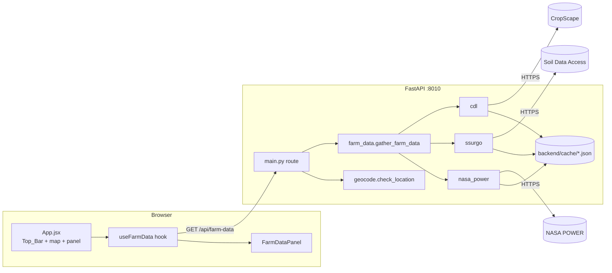

# Design Document

> Restored on 2026-11-15. The file had been emptied, probably by an editor save. This is the design as approved, plus a short "Changes during the build" section at the end that records what changed while the tasks were built.

## Overview

The Farm Data Panel adds one backend endpoint, `GET /api/farm-data?lat=..&lon=..`, and one frontend panel that shows the result. The endpoint queries three public sources at the same time (NASA POWER, USDA SSURGO, USDA NASS CDL), converts every fact into one `Feature_Record` shape, caches successful results on disk, and groups the output by source. A source that fails becomes an `Unavailable_Entry`. The other sources are still returned and the response is still HTTP 200.

The frontend calls only this endpoint. It shows the facts in a frosted panel over the full-screen map, with a Climate / Soil / Crop history switch, a monthly climate chart, and a Source_Tag on every fact.

Design decisions:

| Decision | Choice | Reason |
|---|---|---|
| Backend concurrency | `async` endpoint, `httpx.AsyncClient`, `asyncio.gather` | Meets Req 5.5. Tests use `httpx.MockTransport` with the same client type. |
| HTTP client injection | FastAPI dependency `get_http_client`, overridden in tests | No real network in tests (Req 8.2). |
| Total timeout | `asyncio.wait_for(..., 10)` around every upstream call, plus `httpx.Timeout(10)` | The httpx timeout applies per read, not to the whole call. `wait_for` enforces the 10 s limit (Req 5.3). |
| Cache | One JSON file per source and rounded location in `backend/cache/` | Matches Req 6. Easy to inspect and delete by hand. |
| Location validation | Reuse `parse_coordinates` and `is_in_us` from `geocode.py` through one new helper | Req 7.4. No duplicated rules. |
| CDL projection | Small pure-Python Albers (EPSG:5070) function | CropScape wants Albers x/y. This avoids adding `pyproj`, which has native wheels. |
| Frost and heat values | Computed from 10 years of NASA POWER daily data | The climatology endpoint has only monthly values. |
| Frontend packages | None added | Req 17.5. React 18, Vite, MapLibre, Recharts only. |

## Architecture



Request flow for one location:

1. The route validates `lat` and `lon` (400 on bad input).
2. `gather_farm_data` starts the three Source_Services with `asyncio.gather`.
3. Each service checks the Disk_Cache. On a hit it returns the cached records marked `cached`.
4. On a miss it calls upstream, builds records marked `live`, and writes them to the cache.
5. Any failure inside a service becomes an `Unavailable_Entry` for that source only. The failure is logged by source name and error type.
6. The route returns the grouped JSON with status 200.

### File layout

```
backend/
  app/
    main.py              # adds /api/farm-data route and http client dependency
    geocode.py           # adds check_location() that reuses existing rules
    farm_data.py         # orchestrator: gather, group, never raises
    records.py           # Feature_Record, Unavailable_Entry, constructors
    cache.py             # Disk_Cache read/write
    projection.py        # lat/lon -> EPSG:5070 Albers x/y
    services/
      __init__.py
      base.py            # SourceUnavailable, fetch helpers with 10 s limit
      nasa_power.py
      ssurgo.py
      cdl.py
  cache/                 # created at runtime, already in .gitignore
  tests/
    fixtures/            # saved upstream responses
    test_records.py  test_cache.py  test_nasa_power.py
    test_ssurgo.py   test_cdl.py    test_farm_data_api.py
  verify.py              # extended with a live farm-data check
frontend/src/
  App.jsx                # restyled Top_Bar, full-screen map, panel
  TerrainMap.jsx         # accepts a padding prop so the marker is not under the panel
  LocationSearch.jsx     # visible label, restyled
  farmData/
    useFarmData.js       # fetch, abort stale requests, retry
    FarmDataPanel.jsx    # shell, segmented control, live region, disclaimer
    SegmentedControl.jsx
    ClimateView.jsx  ClimateChart.jsx
    SoilView.jsx     CropHistoryView.jsx
    SourceTag.jsx    ViewState.jsx   # loading / empty / error
    format.js            # resolution and value formatting (pure functions)
    usePrefersReducedMotion.js
  index.css              # theme tokens, frosted surfaces, responsive rules
```

`Farmers-Helpers/` is only read for reference. Nothing imports from it and nothing in it changes. The new code never reads `.env`, because none of the three sources needs a key.

## Components and Interfaces

### Backend API

`GET /api/farm-data?lat=<number>&lon=<number>`

`lat` and `lon` are declared as optional strings. This lets the route return the plain-language 400 messages from Req 7 instead of FastAPI's default 422 body.

New helper in `geocode.py`:

```python
def check_location(lat_text: str | None, lon_text: str | None) -> tuple[float, float]:
    """Parse, range-check and US-check a location. Raises GeocodeError with a plain message."""
```

It calls `parse_coordinates(f"{lat}, {lon}")`. A `None` result means "not a number" or missing. Out-of-range values raise from `parse_coordinates` already. It then calls `is_in_us`. The existing "outside the US" message becomes a shared constant used by both `_result` and `check_location`. Existing geocode behaviour and tests do not change.

Success response (always 200 once the location is valid):

```json
{
  "location": {"lat": 30.28, "lon": -98.87},
  "sources": {
    "nasa_power": {"status": "ok", "records": [ /* Feature_Record */ ]},
    "ssurgo":     {"status": "unavailable", "source": "USDA SSURGO", "reason": "no soil survey data for this location"},
    "cdl":        {"status": "ok", "records": []}
  }
}
```

`status: "ok"` with an empty `records` list means "the source answered and has nothing here". `status: "unavailable"` means "the source failed or has no data and we explain why". The frontend maps these to the empty state and the error state (Req 12).

Errors: 400 `{"detail": "<plain message>"}` for missing, non-numeric, out-of-range, and non-US input.

### Source_Service contract

Each service is one async function:

```python
async def fetch(client: httpx.AsyncClient, lat: float, lon: float, cache: DiskCache) -> list[FeatureRecord]
```

It returns records, or raises `SourceUnavailable(reason)` with a farmer-readable reason. The orchestrator turns that into an `Unavailable_Entry`. Any other exception (timeout, `httpx.HTTPError`, `ValueError`, `KeyError`, `json` errors) is caught in the orchestrator and given a generic reason such as "NASA POWER did not respond in time" or "NASA POWER sent data we could not read".

`services/base.py` provides:

- `SourceUnavailable(Exception)`.
- `async get_json(client, url, params)` and `async post_json(client, url, body)`. Both wrap the call in `asyncio.wait_for(..., 10)`, call `raise_for_status()`, and parse JSON.

### Feature_Record

```python
class FeatureRecord(TypedDict):
    variable: str          # "temperature_mean", "soil_organic_matter", "crop_type", ...
    source: str            # display name, e.g. "NASA POWER"
    resolution_m: int      # 50000, 250, 30
    date: str              # see below
    value: float | int | str
    units: str             # "°C", "mm", "kWh/m²/day", "%", "days/year", "month-day", ""
    live_or_cached: Literal["live", "cached"]
```

`date` is always a string:

| Kind of fact | `date` |
|---|---|
| Monthly climate normal | month number, `"01"` to `"12"` |
| Frost and heat estimates | the 10-year period, e.g. `"2016-2025"` |
| Soil facts | `"current survey"` |
| Crop history | the CDL year, e.g. `"2024"` (Req 3.3) |

`records.py` has one constructor, `make_record(...)`, that fills all seven fields. Services never build dicts by hand, so no record can miss a field (Req 8.5).

### NASA_POWER_Service

Two upstream calls, run concurrently, both on `https://power.larc.nasa.gov/api/temporal/...` with `community=AG`:

1. Climatology point: parameters `T2M, T2M_MIN, T2M_MAX, PRECTOTCORR, ALLSKY_SFC_SW_DWN`. Gives 12 monthly values for each.
2. Daily point for the last 10 complete calendar years: parameters `T2M_MIN, T2M_MAX`. Used for frost and heat estimates.

Records produced:

| variable | units | count |
|---|---|---|
| `temperature_mean`, `temperature_min`, `temperature_max` | °C | 12 each |
| `precipitation` (mm/day × days in month) | mm | 12 |
| `solar_radiation` (only when present) | kWh/m²/day | 12 |
| `frost_days_per_year` | days/year | 1 |
| `last_spring_frost` | month-day | 1 |
| `first_fall_frost` | month-day | 1 |
| `heat_days_per_year` (max temp above 35 °C) | days/year | 1 |

Every record has `resolution_m = 50000` and `source = "NASA POWER"`.

Frost and heat estimate rules (pure function `estimate_frost_heat(daily_min, daily_max)`, tested on its own):

- Skip the NASA fill value `-999` and any year with more than 10% missing days.
- A frost day is a day with minimum temperature of 0 °C or below. A heat day has maximum temperature above 35 °C.
- `frost_days_per_year` and `heat_days_per_year` are the mean yearly counts.
- For each year, the last spring frost is the last frost day before 1 July and the first fall frost is the first frost day from 1 July on. The reported dates are the median day-of-year across years that had a frost.
- If no year has a frost, the two frost dates are omitted and `frost_days_per_year` is 0. If the daily call fails or is unusable, all four estimate records are omitted and the monthly records stay (Req 1.6).

If the climatology call fails, or any monthly parameter for temperature or precipitation is missing, the whole source is unavailable. The Climate_Chart cannot work without those values.

### SSURGO_Service

One POST to `https://sdmdataaccess.sc.egov.usda.gov/Tabular/post.rest` with `format=JSON+COLUMNNAME`. The SQL finds the map unit at the point with `SDA_Get_Mukey_from_intersection_with_WktWgs84('point(lon lat)')`, picks the component with the largest `comppct_r`, and reads these columns. The query text is built only from the validated float values.

| Record | Column |
|---|---|
| `soil_map_unit_name` | `mapunit.muname` |
| `soil_organic_matter` (%) | `chorizon.om_r`, surface horizon |
| `soil_texture` | `chtexturegrp.texdesc` for the representative group of the surface horizon |
| `soil_drainage_class` | `component.drainagecl` |
| `soil_hydrologic_group` | `component.hydgrp` |
| `soil_available_water_capacity` (in/in) | `chorizon.awc_r`, surface horizon |
| `soil_erodibility_k` | `chorizon.kffact`, surface horizon |
| `soil_slope_range` (`"low to high %"`) | `component.slope_l`, `slope_h` |

A missing column gives no record for it (Req 2.5). An empty table gives `SourceUnavailable("no soil survey data for this location")` (Req 2.4).

Resolution: SSURGO is polygon data, not a grid. Req 2.3 asks for a `resolution_m` that marks the data as a map-unit average. The design uses `resolution_m = 250` (about the width of a typical small SSURGO polygon) and sets `source = "USDA SSURGO (map-unit average)"`. The panel also prints the Req 11.5 note. The number 250 is a labelling choice and is open to change.

### CDL_Service

For each year from last year back 8 years, one GET to `https://nassgeodata.gmu.edu/axis2/services/CDLService/GetCDLValue?year=Y&x=X&y=Y` where x and y come from `projection.to_albers(lat, lon)`. The 8 calls run concurrently. The response is parsed with a tolerant regular expression that extracts the category (crop) name. `fetch` maps it to a record:

- `variable = "crop_type"`, `value = <crop name>`, `date = "<year>"`, `units = ""`, `resolution_m = 30`, `source = "USDA NASS CDL"`.
- A year with no value (empty category, background, or "no data") is omitted (Req 3.5).
- A year whose call fails is omitted. If every year failed with an error, the source is unavailable. If the years answered but none had a crop, the result is an empty list.
- Records are sorted newest first.

CDL covers the lower 48 only. Alaska and Hawaii locations will come back as an empty list, which the panel shows as the empty state.

Risk: the exact CropScape response text is not documented well. The first implementation task saves a real response as a fixture and writes the parser against it. The live check in `verify.py` then confirms it.

### Orchestrator (`farm_data.py`)

```python
async def gather_farm_data(client, lat, lon, cache) -> dict
```

- Starts the three services with `asyncio.gather(..., return_exceptions=True)`, so one failure cannot cancel the others.
- Converts each result: list → `{"status": "ok", "records": [...]}`; `SourceUnavailable` → unavailable with its reason; any other exception → unavailable with a generic reason.
- Logs `source=<name> error=<ExceptionClass>` for every failure. It never logs URLs with query data, response bodies, or environment values.
- Cannot raise, so the route cannot return 500 because of an upstream problem (Req 8.4).

### Disk_Cache (`cache.py`)

- Path: `backend/cache/<source>_<lat:.2f>_<lon:.2f>.json`, for example `nasa_power_30.28_-98.87.json`.
- `read(source, lat, lon)` returns a list of records with `live_or_cached` set to `"cached"`, or `None` when the file is missing, unreadable, or fails a shape check (a list of dicts that each have all seven fields). A bad file is ignored, not deleted (Req 6.4).
- `write(source, lat, lon, records)` writes to a temp file in the same folder and renames it over the target, so a crash cannot leave half a file. It is called only after a successful live result with at least one record. Failures and empty results are never written (Req 6.5).
- A write error (disk full, permissions) is logged and ignored. The live result is still returned.
- The folder is created on first write. The cache directory is a constructor argument, so tests pass `tmp_path`.
- Records are stored with `live_or_cached = "live"` and flipped to `"cached"` on read.
- CDL caches only when all 8 year calls answered, so a partial result from a flaky moment is not stored as if it were complete.

Two nearby clicks that round to the same 2-decimal cell (about 1 km) share a cache entry. This matches the resolution of the data and Req 6.2.

### Frontend

**`useFarmData(location)`**

Returns `{ status, data, error, retry }` where `status` is `"idle" | "loading" | "loaded" | "error"`.

- On every change of `lat` or `lon` it aborts the previous request with `AbortController` and starts a new one. A request counter in a ref also guards against a response that arrives after its abort, so only the newest response is applied (Req 12.6).
- A network failure or a non-2xx response sets `status: "error"` with a message (Req 12.4).
- `retry()` repeats the request for the current location (Req 12.7). Per-source retry buttons call the same function, because the endpoint returns all sources together.
- It calls only `/api/farm-data` (Req 17.2).

**`FarmDataPanel`**

- Header: location label, collapse button (narrow screens), Segmented_Control.
- Body: the active view only (Req 9.6).
- Footer: "This tool supports your judgment and does not replace it." (Req 11.6).
- A visually hidden `role="status"` / `aria-live="polite"` element announces: "Loading farm data", "Farm data loaded", "Soil data unavailable: <reason>", "Could not load farm data" (Req 15.3).

**`SegmentedControl`** follows the ARIA tabs pattern: `role="tablist"`, each option `role="tab"` with `aria-selected` and `aria-controls`, roving `tabindex` (only the selected tab is in the Tab order), Left and Right arrows move and select, and Home and End jump to the ends. The body is a `role="tabpanel"` labelled by the selected tab (Req 15.2).

**`ClimateView`**

- Big numbers: annual precipitation (sum of the 12 months), mean temperature, frost days per year, heat days per year, last spring and first fall frost. Each shows the value, unit, and a text label (Req 9.7).
- `ClimateChart` below the numbers.
- Note: "NASA POWER data covers about 50 km. It describes regional climate, not your field." (Req 11.4).
- One `SourceTag` for the group.

**`ClimateChart`**

- Recharts `ComposedChart`: `Line` for mean temperature (left axis, °C) and `Bar` for precipitation (right axis, mm), x axis January to December (Req 10.1, 10.2).
- `Tooltip` shows both values on hover and keyboard focus. The chart uses Recharts' `accessibilityLayer` prop for keyboard focus. The installed Recharts version must support it; the implementation task checks this and falls back to focusable month buttons if it does not.
- A visually hidden `<table>` with a caption and 12 rows is the text alternative (Req 10.4).
- `isAnimationActive={!prefersReducedMotion}` on the line and the bars (Req 10.5).

**`SoilView`**: map unit name as the heading, then big numbers for organic matter, available water capacity, and erodibility K, and smaller labelled rows for texture, drainage class, hydrologic group, and slope. Note: "SSURGO values are map-unit averages. They are not measurements of your field." (Req 11.5).

**`CropHistoryView`**: a list of year and crop, newest first, with a `SourceTag` for the group.

**`SourceTag`**: text such as `NASA POWER · about 50 km · live`. `format.js` exports `formatResolution(m)`: 1000 and above is kilometres, below 1000 is metres (Req 11.2, 11.3). Values like 50000 print as "50 km", 250 as "250 m", and 30 as "30 m". It is a pure function and the first place to test if a frontend test runner is ever added.

**`ViewState`** renders the three non-data states for a view:

- Loading: a skeleton block with `aria-busy="true"`.
- Empty: "No data exists for this location." (Req 12.3).
- Error: reason text and a "Try again" button (Req 12.2, 12.4). The other views stay usable.

**`App.jsx`**

- Layout: the map fills the viewport (`position: fixed; inset: 0`). The Top_Bar and the panel float above it.
- Top_Bar contents: title, demo farm buttons, `LocationSearch`, and one short line with the selected place name. The long help sentence is removed (Req 13.4).
- Location sources stay as they are: search, demo farm, and map click all call `setLocation`, which drives `useFarmData` (Req 12.5).
- `TerrainMap` gets a `padding` prop. On wide screens the right padding equals the panel width plus margin, on narrow screens the bottom padding equals the sheet height. `flyTo` uses it, so the marker lands in the uncovered part of the map (Req 9.3).

**`LocationSearch`** gets a visible `<label htmlFor>` tied to the input and drops `size={45}` in favour of CSS width so the Top_Bar fits narrow screens (Req 13.5, 16.4).

### Visual system (`index.css`)

Design tokens as CSS custom properties with a dark override in `@media (prefers-color-scheme: dark)`.

| Token | Light | Dark |
|---|---|---|
| `--surface` | `rgba(255,255,255,0.86)` | `rgba(28,28,30,0.86)` |
| `--text` | `#1d1d1f` | `#f5f5f7` |
| `--text-secondary` | `#515154` | `#c7c7cc` |
| `--border` | `rgba(0,0,0,0.35)` for control outlines, `rgba(0,0,0,0.08)` for decorative lines | `rgba(255,255,255,0.45)` and `rgba(255,255,255,0.12)` |
| `--accent` | `#0071e3` | `#0071e3` |
| `--accent-text` | `#0066cc` | `#2997ff` |

- Font stack from Req 13.1. Corners 14 px on the panel and Top_Bar, pill radius on buttons, inputs, and the segmented control. Shadow `0 8px 30px rgba(0,0,0,0.18)`.
- Frosted effect: `backdrop-filter: saturate(180%) blur(20px)` with the `--surface` colour. A solid-colour fallback via `@supports not (backdrop-filter: blur(1px))` so text stays readable where blur is missing.
- The accent `#0071e3` is used for filled buttons with white text (4.7:1), the selected segment, and focus rings. On the dark theme `#0071e3` as text on the dark surface is only about 3.7:1, so link-like text uses `--accent-text` instead. Focus rings are 2 px solid accent with a 2 px offset, which meets the 3:1 rule for component boundaries on both themes (Req 14.3, 15.1).
- Contrast on frosted surfaces: because the surface is 86% opaque, the worst case is a pure white or pure black map behind it. The text tokens above are checked against those worst-case blends, not just the surface colour (Req 14.4).
- Reduced motion: the panel slide-in is a CSS animation wrapped in `@media (prefers-reduced-motion: no-preference)`. A `reduce` block sets `transition: none; animation: none` for everything else.
- Narrow screens (`max-width: 767px`): the panel becomes a bottom sheet with `left: 0; right: 0; bottom: 0; width: 100%; max-height: 60vh; overflow-y: auto; border-radius: 14px 14px 0 0`. The collapse button toggles a `collapsed` state that hides the body and leaves the header. The button has `aria-expanded` and an accessible name that changes between "Collapse panel" and "Expand panel". The Top_Bar wraps its controls (`flex-wrap`) and the search input is `width: 100%` so nothing scrolls sideways.

## Data Models

Backend response, written as TypeScript for readability:

```ts
type FeatureRecord = {
  variable: string; source: string; resolution_m: number;
  date: string; value: number | string; units: string;
  live_or_cached: "live" | "cached";
};
type SourceResult =
  | { status: "ok"; records: FeatureRecord[] }
  | { status: "unavailable"; source: string; reason: string };
type FarmDataResponse = {
  location: { lat: number; lon: number };
  sources: { nasa_power: SourceResult; ssurgo: SourceResult; cdl: SourceResult };
};
```

Cache file: a JSON array of `FeatureRecord`.

Frontend state in `App`: `location` (unchanged shape: `lat, lon, label, source`), plus `useFarmData` state and `view` (`"climate" | "soil" | "crops"`) kept in `FarmDataPanel`. The selected view persists when the location changes.

## Correctness Properties

1. **Complete records.** Every record in every response, fresh or cached, has all seven fields, and `live_or_cached` is `"live"` or `"cached"`. (Req 4.1, 4.2, 8.5)
2. **Cache provenance.** A record read from the cache is `"cached"`. A record built from an upstream call in this request is `"live"`. (Req 4.3, 4.4)
3. **Cache round trip.** After a successful live fetch, a second request for a point that rounds to the same cell makes zero upstream calls and returns the same facts. (Req 6.1 to 6.3)
4. **Failures are not cached.** After any source failure the cache folder is byte-for-byte unchanged for that source. A malformed cache file is ignored and replaced only by a good live result. (Req 6.4, 6.5)
5. **Isolation.** A failing source never removes or alters another source's result. (Req 5.1)
6. **No 500s from upstream.** Whatever the three upstream services return, a valid US location produces HTTP 200 with three groups. (Req 5.2, 8.4)
7. **Bounded time.** No upstream call runs longer than 10 s, and the three run concurrently, so the total is about the slowest single source and not the sum. (Req 5.3, 5.5)
8. **Validation first.** Invalid or non-US input returns 400 before any upstream call is made. (Req 7)
9. **Only newest wins.** In the frontend, the panel only ever shows data for the most recently selected location. (Req 12.6)
10. **Resolution wording.** `formatResolution` returns kilometres for 1000 and above and metres below 1000, with no rounding that changes the unit. (Req 11.2, 11.3)

## Error Handling

| Situation | Backend result | Panel behaviour |
|---|---|---|
| Missing, non-numeric, or out-of-range coordinates | 400 plain message | The search or map click path already prevents most of these. If one arrives, show the error state with the message. |
| Location outside the US | 400 "This tool only covers US farms." | Error state with that message. |
| One source times out, errors, or returns junk | 200, that source `unavailable` with a reason | That view shows the reason and "Try again". Other views work. |
| SSURGO has no map unit | `unavailable`, "no soil survey data for this location" | Error state in Soil view with that reason. |
| A source answers with no facts | `status: "ok"`, `records: []` | Empty state for that view. |
| All three fail | 200, three `unavailable` entries | Each view shows its own error. The live region announces it once. |
| Backend not running or network down | n/a | Error state in the panel with "Try again". |
| Cache file unreadable or malformed | Ignored, live fetch | None. |
| Cache write fails | Logged, result still returned | None. |
| User picks a new location mid-request | Old request aborted | Old response is discarded. Loading state restarts. |

Logging uses the standard `logging` module with the line `farm_data source=<name> error=<ExceptionClass>`. No URLs with response data, no response bodies, and nothing from `.env` are logged. `.env` values are never copied into responses or frontend code (Req 17.1).

## Testing Strategy

All backend tests run offline with `httpx.MockTransport` and fixtures in `backend/tests/fixtures/`. The app's `get_http_client` dependency is overridden so `TestClient` uses the mock client. The cache directory is `tmp_path`.

Per service (`test_nasa_power.py`, `test_ssurgo.py`, `test_cdl.py`): successful result, timeout (the mock handler raises `httpx.ReadTimeout`), HTTP error (500), malformed response (invalid JSON or missing keys), empty result, and cache hit (the second call uses a handler that fails the test if called). `test_nasa_power.py` also has direct tests of `estimate_frost_heat` with small hand-made daily series (frost year, no-frost year, fill values, missing years) and the 1.6 case where the daily call fails but monthly records remain. `test_cdl.py` also covers a year with no value being dropped and `projection.to_albers` against one known point.

`test_cache.py`: key rounding to 2 decimals, atomic write, malformed file ignored, failure not written, existing entry untouched by a later failure.

`test_records.py`: `make_record` fills all seven fields.

`test_farm_data_api.py`: partial failure (one source down, two fine), all sources down (still 200), never 500 across a table of failure modes, 400 for each invalid input kind, exactly the grouped response shape, and a check that the mock transport was not called when validation fails. A concurrency test uses handlers that each sleep briefly and asserts the total time is below the sum.

A shape test walks every record from every fixture and asserts the seven fields.

`verify.py` gains a live step: it loads the first farm from `config/demo_farms.json`, calls the `farm-data` route through `TestClient` with the real network, and writes one line per source (`ok`, record count, and cache state, or `unavailable` with the reason) to `verify_report.txt`. Because the cache would hide a live failure, the live step uses a temporary cache folder.

Frontend: the project has no test runner and Req 17.5 limits new packages, so there are no automated frontend tests. Coverage comes from `npm run build` (already run by `verify.py`) and this manual checklist, run in Chrome and a phone-size viewport:

- Climate, Soil, and Crop history switch with mouse, Tab, and arrow keys.
- Clicking the map or choosing a demo farm refreshes the panel. Rapid clicks show only the last location.
- Stop the backend and confirm the error state and the retry button. Restart and retry.
- Switch the OS between light and dark and check text contrast in both with the map showing snow or dark water behind the panel.
- Turn on "reduce motion" and confirm no slide-in and no chart animation.
- Turn on a screen reader and confirm the live announcements and the chart's text table.
- At 375 px wide, confirm the Top_Bar has no horizontal scroll, the sheet is at most 60% of the height, scrolls inside itself, and collapses.

## Requirements Coverage

| Requirements | Where addressed |
|---|---|
| 1, 2, 3 | NASA_POWER_Service, SSURGO_Service, CDL_Service |
| 4 | Feature_Record, `make_record`, orchestrator grouping |
| 5 | Orchestrator, `services/base.py`, error handling table |
| 6 | Disk_Cache, existing `.gitignore` entry for `backend/cache/` |
| 7 | `check_location`, route |
| 8 | Testing Strategy, `verify.py` |
| 9, 10, 11, 12 | `FarmDataPanel`, views, `ClimateChart`, `SourceTag`, `ViewState`, `useFarmData` |
| 13, 14, 15, 16 | Visual system, `SegmentedControl`, live region, `App.jsx`, `LocationSearch` |
| 17 | File layout notes, no new frontend packages, `Farmers-Helpers/` untouched |

## Changes during the build

These were decided while the tasks were built. The code is the source of truth for each.

- **CDL retry (task 6):** live timing showed that a random 2 to 5 of the 9 CropScape requests hang until timeout. Each year request now gets 4 s with one retry after a timeout (8 s worst case, inside the 10 s limit). Up to 9 years are requested (this year back), keeping the newest 8 with a value. The category name comes straight from CropScape, so there is no code-to-name table.
- **CDL "fault" answers:** a `<faultstring>` reply (year not published yet, or point outside coverage) counts as "no value", even with an HTTP error status. It is not treated as a failure.
- **Demo farm:** the demo farm is Webberwood Ranch, Webberville TX (30.233589, -97.496006). It is a pasture pixel near the ranch address; the listing pin falls on a wooded pixel.
- **Contrast (task 7):** measured against the worst-case blends. Light link text changed to `#0058b0` (5.0:1). The dark surface is 94% opaque instead of 86%, so the accent ring is 3.05:1 and link text 4.75:1. Light control borders are 50% black instead of 35% (3.68:1).
- **Map controls:** zoom, tilt and attribution moved to the bottom-left so the panel does not cover them. On narrow screens they sit above the bottom sheet.
- **Reduced motion:** camera moves are not marked `essential`, so MapLibre jumps instead of flying when the user prefers reduced motion.
- **Map tiles:** the basemap and terrain tiles load directly in the browser from OpenFreeMap and AWS. Req 17.2 now limits the "backend only" rule to data requests, with map tiles as the stated exception.
