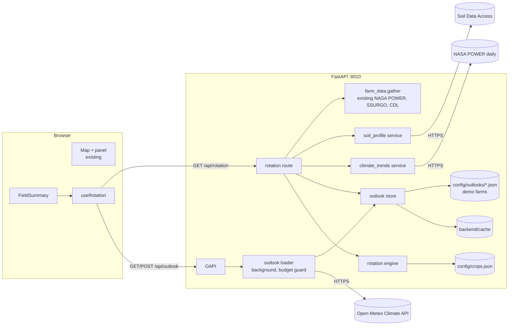

# Design Document

## Overview

The Rotation Explorer adds a scrollable "Your field at a glance" section below the 3D map. The farmer sees:

1. A 3D soil block of the real soil layers.
2. How heat, frost and rain have changed at the field since 1981, and what climate models project for 2030–2049.
3. 3 to 6 plain findings.
4. Priority and constraint controls.
5. At least three rotation strategies, including the current one, scored on today's conditions and on the outlook.

All suggestions come from written rules over a sourced crop table. Every number on screen traces back to a source.

This design is based on live probes of the real services at the Webberwood demo farm (30.233589, -97.496006), run on 14 Nov 2026. The responses are saved under `backend/tests/fixtures/raw_probe/`.

| Probe | Result | Design consequence |
|---|---|---|
| NASA POWER daily, 1981–2025, 5 variables, one request | HTTP 200 in 1.0 s, 1.3 MB, 16,436 days, 0 missing | Trends can be computed live on the first visit, then cached. |
| NASA POWER parameter names | `T2M_MIN`, `T2M_MAX`, `PRECTOTCORR`, `GWETROOT` (0–1), `EVLAND` (mm/day) accepted. `EVPTRNS` is in MJ/m²/day. | Use `EVLAND` for evapotranspiration, so no unit conversion is needed. |
| Open-Meteo Climate API, 1991–2020, 3 models, 3 variables | HTTP 200 in 3.1 s, 0.63 MB, grid point 30.2, -97.5 | It works, but one request weighs about 2,350 of the free calls. |
| Second Open-Meteo request straight after | HTTP 429, "Minutely API request limit exceeded" | Requests must be at least 60 s apart. A new location costs about 3,900 weighted calls, against free limits of 600 a minute, 5,000 an hour and 10,000 a day. **So the outlook cannot load on every map click** (see Decision 1). |
| Open-Meteo 2030–2049 after the limit reset | HTTP 200 in 2.1 s, 0.42 MB | Data ends on 2050-01-01, so the future period is 2030–2049, not 2031–2050. |

Real results at Webberwood (NASA POWER, Theil–Sen slope with a Mann–Kendall test):

| Indicator | 1981–1990 | 2016–2025 | Per decade | Clear change? |
|---|---|---|---|---|
| Days above 35 °C | 64 | 91 | +10 | Yes (p = 0.003) |
| Nights above 24 °C | 30 | 68 | +11 | Yes (p < 0.001) |
| Frost days | 21 | 12 | −1.7 | Yes (p = 0.04) |
| Yearly rain (mm) | 842 | 771 | −49 | No (p = 0.09) |
| Longest dry spell, heavy-rain days, growing-season soil wetness | — | — | — | No |

The three Open-Meteo models project 26 to 39 more days above 35 °C a year in 2030–2049 than in 1991–2020. They project a change in yearly rain of −104 to +12 mm.

## Key decisions

### Decision 1: How the Open-Meteo outlook is loaded

A new location costs about 3,900 weighted calls, and requests must be 60 s apart. Fetching on every click would use up the free hourly limit after one location.

**Chosen approach:**
- **Precomputed for demo farms.** A script, `backend/scripts/build_outlook.py`, fetches the outlook for every farm in `config/demo_farms.json` and saves the computed indicators (a few KB) to `config/outlooks/<farm_id>.json`. The demo is instant and works offline.
- **On demand for other locations.** The Field_Summary shows a "Load 2030–2049 outlook for this spot" button. The backend runs the two requests in the background, 65 s apart, then caches the result by the Open-Meteo grid cell (0.1°, about 10 km) for 30 days. The page shows "about 1–2 minutes" and polls for the result.
- **Budget guard.** The backend counts weighted calls per hour and per day in `backend/cache/openmeteo_budget.json`. It refuses new loads above 4,500 an hour or 9,000 a day, and gives a plain message. This keeps a margin under the limits.
- **No outlook yet.** Until it loads, strategies are scored on recent conditions only, and the outlook column says "not loaded".

This changes Req 18.1 ("WHEN the Rotation_API receives a Location ... retrieve") and Req 18.8. See "Requirement changes".

### Decision 2: Transparent rules and formulas, not a trained model

Every exclusion, finding and score comes from a written rule with a threshold, and every rule has a unit test. This meets the challenge's explainability goal and fits a 24–48 hour build.

### Decision 3: The trend method

- **Slope:** Theil–Sen, the median of slopes between all pairs of years. One extreme year can't swing it (Req 17.4).
- **Clear-change test:** Mann–Kendall with tie correction, two-sided. "Clear change" means p < 0.05 (Req 17.5).
- **Rare events:** in heavy-rain-day counts most years are 0, so the Theil–Sen slope is 0. For an indicator with zeros in more than half its years, the tool compares the first 15 years with the last 15 years and still applies Mann–Kendall.
- **Heavy rain threshold:** a "heavy rain day" uses a local threshold, the 95th percentile of wet days (at least 1 mm) in 1981–2010, rounded to whole mm. This avoids a fixed 50 mm, which almost never happens at most US sites.
- **Known limit:** year-to-year autocorrelation is not corrected for. This is stated in the information gaps.
- All of this is pure Python, about 60 lines, with no new packages (Req 16.2).

### Decision 4: Delta method for future site facts

Each model's bias is cancelled by its own change: future value = observed 1991–2020 average (NASA POWER) + (model 2030–2049 average − model 1991–2020 average).

For example, Webberwood hot days: observed 70 + model changes of 26 to 39 gives **96 to 109 hot days a year**. The middle value is used for the future suitability rules, and the low and high values are shown as the range.

### Decision 5: Map scrolling with `cooperativeGestures`

MapLibre's built-in `cooperativeGestures: true` gives exactly the desktop behaviour in Req 1.3–1.4: the wheel scrolls the page, and Ctrl plus wheel zooms the map, with a hint. On touch screens, one finger scrolls the page and two fingers pan and pinch-zoom the map. This differs from Req 1.7 as written, and is the standard pattern for a map inside a scrolling page. The hint text is set through MapLibre's `locale` option. See "Requirement changes".

### Decision 6: CSS 3D soil block

The block is a cuboid made of three visible faces (front, side and top) with `transform-style: preserve-3d`. The front and side faces are columns of layer bands with heights in proportion to depth. There is no new package (Req 3.10).

## Architecture



Request flow for `GET /api/rotation`:

1. Validate the location with `check_location`, and validate the priorities and constraints (400 on bad input).
2. Concurrently: `gather_farm_data` (existing, cached), `soil_profile.fetch`, `climate_trends.fetch`, and read the cached outlook if there is one.
3. Build `SiteFacts` from these results. A missing source leaves its facts as `None`.
4. Run the engine: work out the current rotation, run the exclusion rules, build the strategies from templates, score them for today and the outlook, write the explanations, findings and confidence.
5. Return 200 with everything, including which sources are missing.

### File layout

```
config/
  crops.json                  # Crop_Table: 15 sourced entries (Req 5)
  outlooks/webberwood.json    # precomputed Open-Meteo outlook for the demo farm
backend/
  app/
    main.py                   # + /api/rotation, /api/outlook routes
    services/
      soil_profile.py         # all SSURGO layers + flooding/ponding (Req 2)
      climate_trends.py       # POWER daily 1981-..., indicators, trends (Req 17)
      openmeteo.py            # outlook requests, budget guard (Req 18)
    rotation/
      __init__.py
      crops.py                # load + validate crops.json at startup (Req 5.5)
      site_facts.py           # SiteFacts from farm-data + profile + trends + outlook
      indicators.py           # pure functions: yearly indicators from daily series
      trends.py               # Theil-Sen, Mann-Kendall, rare-event handling
      current.py              # current rotation from CDL (Req 6)
      rules.py                # exclusion rules (Req 7.3)
      templates.py            # rotation templates (Req 7.2)
      scoring.py              # six dimensions + overall (Req 10)
      findings.py             # finding rules (Req 4, 17.9)
      explain.py              # why / benefits / risks / gaps / confidence (Req 8)
      engine.py               # orchestrates the above, pure, no I/O
    outlook_store.py          # read precomputed / cached outlook, background loader
  scripts/
    build_outlook.py          # precompute demo-farm outlooks (Decision 1)
  tests/
    fixtures/raw_probe/       # saved POWER daily + Open-Meteo responses (trimmed during build)
    test_rotation_*.py
frontend/src/
  fieldSummary/
    FieldSummary.jsx          # section shell, loading/error, live region
    useRotation.js            # fetch /api/rotation, abort stale, retry
    useOutlook.js             # load/poll /api/outlook
    SoilBlock.jsx             # CSS 3D block + text alternative
    soilColors.js             # texture group -> colour + pattern
    ClimateTrends.jsx         # small-multiple yearly charts with trend lines
    Findings.jsx
    PriorityPicker.jsx        # toggles + constraints, saved in localStorage
    StrategyCard.jsx
    CalendarStrip.jsx
    ScoreBars.jsx
    RuledOut.jsx
    TermInfo.jsx              # plain-language explanations of terms (Req 4.7)
  App.jsx                     # page scrolls: map section 100vh, then FieldSummary
  TerrainMap.jsx              # cooperativeGestures
```

## Components and Interfaces

### Backend API

**`GET /api/rotation`**

| Parameter | Values | Default |
|---|---|---|
| `lat`, `lon` | numbers | required |
| `priorities` | comma list of `save_water, build_soil, forage, income, fewer_passes` | empty |
| `irrigation` | `yes`, `no` | `no` |
| `livestock` | `yes`, `no`, `unknown` | `unknown` |
| `no_till` | `yes`, `no` | `no` |
| `current` | a crop id from `crops.json`; overrides the CDL-based current rotation (Req 6.5) | none |
| *(Phase 2)* `soil_ph`, `soil_om`, `soil_p`, `soil_k`, `soil_test_date`, `soil_depth_cm` | numbers / date | none |
| *(Phase 2)* `outlook_source` | `open_meteo`, `nasa` | `open_meteo` |

An unknown value returns 400 and names the value (Req 13.5).

Response (abridged):

```json
{
  "location": {"lat": 30.2336, "lon": -97.4960},
  "missing_sources": [],
  "soil_profile": {"status": "ok", "component": "Tinn", "flooding": "occasional", "ponding": "none",
    "layers": [{"top_cm": 0, "bottom_cm": 30, "texture": "Clay", "om_pct": 2.5, "clay_pct": 52, "awc": 0.18}],
    "source": "USDA SSURGO (map-unit average)", "resolution_m": 250, "live_or_cached": "cached"},
  "surface_cover": {"value": "Grass/Pasture", "year": "2025", "source": "USDA NASS CDL"},
  "trends": {"status": "ok", "period": "1981-2025", "source": "NASA POWER", "resolution_m": 50000,
    "indicators": [{"id": "hot_days", "label": "Days above 35 °C", "units": "days/year",
      "yearly": [[1981, 52], ["..."]], "per_decade": 10.0, "p_value": 0.003, "clear": true,
      "first_decade_avg": 64.4, "last_decade_avg": 90.8, "method": "theil_sen"}]},
  "outlook": {"status": "ok", "source": "Open-Meteo", "models": ["EC_Earth3P_HR", "MPI_ESM1_2_XR", "MRI_AGCM3_2_S"],
    "recent": "1991-2020", "future": "2030-2049", "resolution_km": 10, "scenario": "high emissions (close to RCP8.5)",
    "indicators": [{"id": "hot_days", "change": {"low": 25.7, "mid": 28.2, "high": 38.7},
      "future_value": {"low": 95.9, "mid": 98.4, "high": 108.9}}],
    "licence": "CC BY 4.0, Open-Meteo.com"},
  "findings": [{"id": "rising_heat", "title": "Hot days are rising",
    "text": "About 10 more days above 35 °C per decade since 1981, from 64 a year in the 1980s to 91 now.",
    "evidence": [{"value": 10.0, "units": "days/decade", "source": "NASA POWER", "resolution_m": 50000}],
    "terms": ["hot_day"]}],
  "current_rotation": {"crop_ids": ["bermudagrass"], "label": "Pasture (bermudagrass or native grass)",
    "evidence": "Grass/Pasture in 7 of 8 years (2018-2025)", "inferred": true},
  "strategies": [{"id": "current", "name": "Current: continuous pasture", "is_current": true,
    "sequence": [{"crop_id": "bermudagrass", "months": [4,5,6,7,8,9,10], "year": 1}],
    "calendar": [{"month": 1, "crop_id": null, "bare": true, "heat": false, "frost": true, "wettest": false}],
    "scores": {"today": {"water": 70, "soil": 55, "erosion": 60, "forage": 80, "income": 40, "passes": 95, "overall": 66},
               "outlook": {"overall": 58}},
    "score_parts": {"water": [{"label": "Crop water need: medium", "points": 50}]},
    "why": [{"text": "...", "evidence": [{"value": "D", "source": "USDA SSURGO"}]}],
    "benefits": ["..."], "risks": [{"text": "...", "local_review": true}],
    "future_risks": [{"crop_id": "...", "indicator": "hot_days", "today": 91, "future_mid": 98, "limit": 95}],
    "gaps": ["No soil test for pH, phosphorus or potassium"],
    "soil_health_notes": [{"crop_id": "hairy_vetch", "text": "Fixes nitrogen from the air ..."}],
    "confidence": "high", "missing_facts": []}],
  "exclusions": [{"crop_id": "crimson_clover", "rule": "wet_soil", "text": "Does not tolerate wet soil; this soil is group D and occasionally flooded", "value": "D, occasional"}],
  "ranking_note": "Ranked by your priorities. A starting point to discuss with your county extension agent."
}
```

**`GET /api/outlook?lat&lon`** returns `{"status": "ready" | "not_loaded" | "loading" | "unavailable", "reason"?, "eta_s"?}`.

**`POST /api/outlook/load?lat&lon`** starts the background load if the budget allows it. It returns 202 with `loading`, or 200 with `ready` if the outlook is already cached or precomputed. It returns 200 with `unavailable` and a reason when the budget is exhausted. It never returns 500.

### Soil profile service (`soil_profile.py`)

This is one POST to Soil Data Access, built only from validated floats like the existing `ssurgo.py`.

- It reads all `chorizon` rows of the dominant component (highest `comppct_r`): `hzdept_r`, `hzdepb_r`, `om_r`, `claytotal_r`, `awc_r`, and the representative texture from `chtexturegrp.texdesc` where `rvindicator = 'Yes'`.
- Rows are ordered by `hzdept_r` (Req 2.2–2.3).
- Flooding and ponding come from the `comonth` table: the most frequent `flodfreqcl` and `pondfreqcl` across months, ranked none < very rare < rare < occasional < frequent < very frequent (Req 2.4).
- A missing property is omitted per layer (Req 2.5). An empty result gives "no soil survey data for this location" (Req 2.6).
- The cache key is `soil_profile_<lat>_<lon>`, with the existing Disk_Cache rules (Req 2.7).
- Risk: the `comonth` query is not verified yet. The first build task saves a live response as a fixture.

### Climate trends service (`climate_trends.py`, `rotation/indicators.py`, `rotation/trends.py`)

- **Fetch:** one NASA POWER daily request, `T2M_MIN,T2M_MAX,PRECTOTCORR,GWETROOT,EVLAND`, from 1 January 1981 to 31 December of the last complete year. The 10 s limit applies; the probe took 1.0 s. If the request fails, trends are unavailable with a reason (Req 17.11).
- **Cache:** the computed indicators (a few KB), not the 1.3 MB raw file. The cache key includes the last complete year, so a new year's data is picked up automatically, at most once a year (Req 17.10).
- **Indicators**, from pure functions over `{date: value}`, skipping years with more than 10% of days missing (Req 17.3):

| id | Definition | Units |
|---|---|---|
| `hot_days` | days with max > 35 °C | days/year |
| `warm_nights` | days with min > 24 °C | days/year |
| `frost_days` | days with min ≤ 0 °C | days/year |
| `last_spring_frost` | last frost day before 1 July | day of year |
| `first_fall_frost` | first frost day from 1 July | day of year |
| `rain_total` | sum of precipitation | mm/year |
| `rain_growing` | precipitation April–September | mm |
| `dry_spell` | longest run of days < 1 mm | days |
| `heavy_rain_days` | days above the local 95th-percentile wet-day threshold (1981–2010) | days/year |
| `water_balance` | rain − EVLAND | mm/year |
| `soil_wetness` | mean GWETROOT April–September | 0–1 |

- **Trend per indicator:** `per_decade` (Theil–Sen × 10, or the first-15 versus last-15 difference for rare events, with `method` recorded), `p_value` (Mann–Kendall), `clear` (p < 0.05), and the first-decade and last-decade averages (Req 17.6–17.7).
- **Recent site facts** for the engine are the averages of the last 10 complete years. They are more current than the farm-data climatology. The farm-data panel keeps its own climatology unchanged.

### Outlook (`openmeteo.py`, `outlook_store.py`, `scripts/build_outlook.py`)

- **Requests:**
  - `daily=temperature_2m_max,temperature_2m_min,precipitation_sum` for the models `EC_Earth3P_HR, MPI_ESM1_2_XR, MRI_AGCM3_2_S`. All three have daily min and max temperature (per the Open-Meteo model table).
  - Two requests: 1991-01-01 to 2020-12-31, then a wait of 65 s, then 2030-01-01 to 2049-12-31.
  - Default bias correction stays on.
- **Weight per request:** `days / 14 × max(1, variables / 10) × models`, about 2,348 + 1,565 = 3,913. This is the documented rule. Open-Meteo doesn't return the weight, so the guard is an estimate with a margin.
- **Indicators:** those Open-Meteo can supply: `hot_days`, `warm_nights`, `frost_days`, `last_spring_frost`, `first_fall_frost`, `rain_total`, `rain_growing`, `dry_spell`, `heavy_rain_days`. `water_balance` and `soil_wetness` are not available.
  - The heavy-rain threshold is each model's own 95th percentile of wet days in 1991–2020, not the NASA POWER one. The change in heavy-rain days is then measured on the model's own scale, so its rain bias cancels like the other deltas. (Changed during task 5.)
- **Values:** the change for each model is future average − recent average. The outlook gives the low, middle and high change across models, and the future value = POWER 1991–2020 observed + change (Decision 4).
- **Storage:**
  - Precomputed demo-farm files: `config/outlooks/<farm_id>.json`, recording the models, periods, fetch date and licence. `build_outlook.py` can build from saved responses (`--recent`, `--future`, `--fetched-on`), so `webberwood.json` was made from the responses saved during the probe on 2026-11-15, with no new calls.
  - On-demand results: Disk_Cache key `outlook_<lat 1dp>_<lon 1dp>`, kept for 30 days.
  - Lookup order: precomputed farm file (the location is within the farm's 1 km box), then the cache, then "not loaded".
- **Background loader:** FastAPI `BackgroundTasks`, with one load at a time (a process lock). Status lives in memory, which is enough for one server process.

### Crop table (`config/crops.json`, `rotation/crops.py`)

```json
{
  "_comment": "Values written for Central Texas (USDA zone 8b, ~800 mm rain). Check locally. Each value cites a source.",
  "crops": [{
    "id": "hairy_vetch", "name": "Hairy vetch", "category": "legume_cover",
    "annual": true, "season": "cool", "plant_months": [9, 10, 11], "in_ground_months": [10, 11, 12, 1, 2, 3, 4],
    "water_need": "low", "drought_tolerance": "medium", "heat_tolerance": "low", "frost_tolerance": "high",
    "wet_soil_tolerance": "medium", "nitrogen_fixing": true, "root_depth": "medium",
    "forage_value": "medium", "residue": "medium", "erosion_protection": "high",
    "pest_families": ["legume"], "income": "none", "field_passes_per_year": 2,
    "limits": {"min_rain_mm_rainfed": 380, "max_hot_days_in_season": null, "min_frost_days_tolerated": null},
    "sources": [{"title": "Hairy Vetch, Managing Cover Crops Profitably (SARE)", "url": "https://www.sare.org/..."}]
  }]
}
```

- The 15 ids are those in Req 5.1. `pest_families` uses shared groups (for example grass/cereal, legume, malvaceae for cotton, sorghum group) for the back-to-back rule (Req 7.6).
- All values and source URLs are filled in during a build task, from SARE *Managing Cover Crops Profitably*, USDA NRCS Plant Guides and Texas A&M AgriLife Extension publications. Each URL is checked to load before it's committed. The values above are placeholders.
- `crops.py` validates the file at startup: required keys, enum values, months 1–12, at least one source with a title and an http(s) URL. A bad file stops the app with a message naming the crop and the field (Req 5.5).

### Current rotation (`rotation/current.py`)

- The CDL category names map to crop ids with a small table, for example `Grass/Pasture` → `bermudagrass`, `Corn` → `corn`, `Winter Wheat` → `winter_wheat_grain`, `Sorghum` → `grain_sorghum`. `Dbl Crop WinWht/Soybeans` maps to two crops.
- **Continuous:** one category in at least 6 of the available years (Req 6.2). The label shows "in N of M years".
- **Alternating:** if no category reaches 6, the 2–3 most common farm categories in order form the sequence (Req 6.3).
- **Not farmland:** if more than half the years are forest, developed, water, wetland or "no data", the current rotation is `unknown` with a reason (Req 6.5). The frontend then asks the farmer to pick one, and sends it as `current`.
- For Webberwood: Grass/Pasture in 7 of 8 years (Evergreen Forest in 2023), so the current rotation is continuous pasture.

### Site facts (`rotation/site_facts.py`)

`SiteFacts` is a plain dataclass. Every field is optional and carries its source:

- **Climate, recent** (last 10 years of POWER daily): hot days, warm nights, frost days, last and first frost dates, yearly and growing-season rain, wettest month (from the farm-data monthly normals), heat-stress months (monthly average daily high > 35 °C, Req 11.2), frost months (Req 11.4).
- **Climate, future:** the same fields from the outlook middle value, plus the low and high values.
- **Soil:** hydrologic group, drainage class, flooding, ponding, slope range, surface organic matter, available water capacity, erodibility K, and surface texture group.
- **Farm:** priorities and constraints from the request.

### Exclusion rules (`rotation/rules.py`)

Each rule is a function `(crop, facts, period) -> Exclusion | None`, run for `period = "today"` and `"outlook"`:

| Rule | Excludes when | Example at Webberwood |
|---|---|---|
| `wet_soil` | `wet_soil_tolerance == "low"` and (flooding at least occasional, or ponding at least occasional, or drainage somewhat poorly drained or wetter). Hydrologic group D on its own is **not** an exclusion: it means slow infiltration, and the group D Blackland clays of Central Texas widely grow cotton and corn. It adds a runoff risk to the strategy instead. | crimson clover, cowpea, sunn hemp, cotton (Tinn clay is occasionally flooded) |
| `heat` | crop grows in a heat-stress month and `heat_tolerance == "low"`, or hot days exceed `limits.max_hot_days_in_season` | cool-season crops kept to Oct–Apr are not affected |
| `frost` | crop grows over winter and `frost_tolerance == "low"` and frost days above its limit | — |
| `water` | `water_need == "high"`, irrigation = no, and yearly rain < `limits.min_rain_mm_rainfed` | corn and soybean if the limit is above about 770 mm |
| `livestock` | constraint livestock = no and the template's main purpose is grazing (Req 7.8) | applies to strategies, not crops |

A crop that passes today but fails under the outlook is kept, and is reported in `future_risks` with the indicator, today's value, the future middle value and the crop's limit (Req 18.7).

### Rotation templates (`rotation/templates.py`)

A template is a named list of slots. Each slot lists candidate crops in order of preference, plus the months and the year in the cycle. The engine fills each slot with the first candidate that isn't excluded today. A template with an unfillable slot is skipped. The back-to-back pest-family rule (Req 7.6) and the in-season months rule (Req 7.7) are checked after filling.

| id | Name | Slots (candidates in order) | Main purpose |
|---|---|---|---|
| `add_winter_legume` | Keep the current crop, add a winter legume | current summer crop; Oct–Apr: hairy vetch → crimson clover → winter wheat cover | soil |
| `forage_double` | Summer forage + winter grazing | May–Sep: sorghum-sudangrass → cowpea; Oct–Apr: forage oats → annual ryegrass | forage (needs livestock ≠ no) |
| `native_perennial` | Native warm-season grass with a cool-season legume | perennial native mix; interseed hairy vetch | erosion and water |
| `drought_row` | Drought-tolerant row rotation (3 years) | Y1 grain sorghum + winter wheat cover; Y2 cotton → soybean + cereal cover; Y3 winter wheat grain + summer sunn hemp → cowpea | income |
| `cover_only` | Current crop + a cereal cover | current crop; Oct–Apr winter wheat cover | fallback that is always fillable |

The engine returns the current rotation plus the best 3 fillable alternatives. `cover_only` guarantees at least two alternatives where the current crop exists; if it doesn't, `native_perennial` stands in (Req 7.1). A test checks this for every fixture.

### Scoring (`rotation/scoring.py`)

Each dimension is 0–100, and the parts are returned for display (Req 10.2). Category values map to numbers: low 0, medium 50, high 100 (for water need, inverted).

| Dimension | Formula, averaged over the months in the cycle |
|---|---|
| `water` | 100 − mean water need of the crops in the ground. −20 if a high-need crop grows in a heat-stress month without irrigation. +10 if every crop has high drought tolerance. |
| `soil` | 40 × share of months with living roots + 20 if a legume is present + 20 × mean residue score + 20 if any crop has deep roots |
| `erosion` | 100 × share of months with cover, weighted by erosion protection. The wettest month and heavy-rain months count double. Then × (1 − 0.5 × site risk), where site risk = max(K / 0.5, slope high / 15) capped at 1. |
| `forage` | mean forage value of grazed months × (livestock ≠ no) |
| `income` | the crop table's `income` category per crop (none 0, low 33, medium 66, high 100), averaged. Labelled "rough guide without local prices" (Req 10.6). Phase 2 adds Quick Stats. |
| `passes` | 100 − 10 × (field passes per year − 1), floor 0. No-till only: −30 for a crop needing tillage. |

- **Overall:** a weighted mean, with weight 2 for the dimensions linked to the selected priorities and 1 for the others (Req 10.3).
- **Outlook score:** the same formulas with future site facts, −15 for each crop in `future_risks`. It's shown next to today's score (Req 18.6).
- **Determinism:** no randomness, and ties are broken by template order (Req 10.5).
- The score numbers are starting values and will be tuned against the source notes during the build. The tests pin behaviour, not exact numbers, except for the determinism test.

### Findings (`rotation/findings.py`)

Rules run in priority order, and the first 6 that apply are kept (Req 4.1). Each one cites its values (Req 4.3):

1. `rising_heat`: the hot-days trend is clear and ≥ +3 per decade.
2. `warm_nights`: the warm-nights trend is clear (night heat stresses crops and livestock).
3. `fewer_frosts`: the frost-days trend is clear and falling (longer season, but more pests survive winter).
4. `outlook_heat`: outlook loaded, middle change in hot days ≥ 10.
5. `slow_soak`: hydrologic group C or D, or drainage somewhat poorly drained or wetter.
6. `flood_risk`: flooding or ponding at least occasional.
7. `erosion_risk`: K ≥ 0.32 or slope high ≥ 8 %.
8. `low_om`: surface organic matter < 2 %.
9. `bare_soil`: the current rotation leaves bare soil in the wettest month or in 2 or more consecutive months (Req 4.5).
10. `rain_variable`: the coefficient of variation of yearly rain ≥ 20 % (water planning).
11. `drying`: the water-balance or soil-wetness trend is clear and falling.

### Explanations (`rotation/explain.py`)

- **Why:** generated from the template purpose and the strongest matching finding, always with ≥ 1 evidence value (Req 8.2).
- **Benefits and risks:** from crop attributes, for example "cool-season grazing fills the winter forage gap" or "hairy vetch can become a weed if it sets seed".
  - Each template has fixed local-review risks, such as termination timing and seeding rates (Req 8.3, 12.4).
- **Gaps:** always included: no soil test (pH, P, K), no market prices, no equipment data. Missing sources are added when they apply (Req 8.4).
- **Soil-health notes:** one sentence for each legume, cover, deep-rooted or drought-tolerant crop (Req 8.5).
- **Confidence:**
  - high: all of farm-data, the profile and trends are present;
  - medium: one is missing, or the outlook isn't loaded;
  - low: soil or CDL is missing, or the current rotation was chosen by the farmer without CDL evidence.

  Missing facts are listed (Req 8.6).

### Frontend

**Page layout:** `App` becomes a scrolling page.
- The map section is `100vh` with the existing top bar and panel, unchanged inside it.
- `FieldSummary` follows it in normal flow. A "Your field summary ↓" pill button over the map scrolls to it, with smooth scrolling unless reduced motion is on (Req 1.2).
- `TerrainMap` adds `cooperativeGestures: true`, with the hint text set through MapLibre `locale` (Req 1.3–1.4).

**`useRotation(location, priorities, constraints, current)`:**
- Built like `useFarmData`: abort stale requests, retry, and an error state.
- A priority change re-requests with a 300 ms debounce (Req 9.3).
- Priorities and constraints are stored in `localStorage` under `fieldshift.priorities.v1` (Req 9.5–9.6).

**`useOutlook(location)`:**
- Calls `GET /api/outlook` first.
- If the result is `not_loaded`, it shows the load button. After `POST`, it polls every 10 s until `ready`, then re-requests the rotation.

**`FieldSummary`** sections, in order:

1. **Header:** the place name, then a disclaimer card with the regional / map-unit / satellite caveats and "a starting point to discuss with your county extension agent" (Req 12).
2. **"Your soil" row:** `SoilBlock` on the left, and on the right the soil facts with `TermInfo` buttons.
3. **"How your climate is changing":** `ClimateTrends`.
   - Small multiples, one Recharts `ComposedChart` per indicator: yearly points, the trend line, the first-decade and last-decade averages, and the outlook band as a shaded range.
   - Each one has "about +10 hot days per decade" and a clear or "no clear change" chip, plus a visually hidden data table.
   - The outlook source and licence line sits under the section (Req 17.6–17.8, 18.4–18.5, 18.11).
4. **"What stands out":** `Findings`, as cards with a title, one sentence and a source line.
5. **"What matters to you":** `PriorityPicker`.
   - Toggle buttons with `aria-pressed`, and segmented radios for the constraints (Req 9.1–9.2, 15.4).
   - If the current rotation is unknown, a crop select appears here (Req 6.5).
6. **"Rotation options":** a `StrategyCard` grid.
   - The current card is pinned first and labelled "Current". The others are ordered by overall score, and the top one is labelled "Best fit for your priorities" (Req 9.4, 9.7).
   - A live region announces the new top strategy after re-ranking (Req 15.5).
7. **"Ruled out for this field":** `RuledOut`.
8. **Footer:** "This tool supports your judgment as a farmer. It does not replace it." (Req 12.5).

**`StrategyCard`:**
- **Top:** the name, the crop sequence (each crop name opens its sources, Req 8.7), and the `CalendarStrip`.
- **Scores:** `ScoreBars` showing the six dimensions for today, an overall today versus outlook pair, and a "How was this scored?" disclosure listing the score parts (Req 10.4).
- **Expandable sections:**
  - Why, with evidence chips;
  - Benefits;
  - Risks to check locally, in an amber style with an icon (Req 12.4);
  - Future risks;
  - Soil-health notes;
  - Information gaps;
  - Confidence, with the missing facts.

**`CalendarStrip`:**
- 12 cells, each coloured by the crop's colour.
- Bare soil uses a diagonal hatch pattern, heat stress a ☀ marker on top, frost a ❄ marker, and the wettest month a 💧 marker. These are text glyphs with `aria-hidden`, and each cell has an `aria-label` such as "May: bare soil, wettest month" (Req 11.5–11.6).
- A legend sits below.

**`SoilBlock`:**
- **Structure:** a wrapper with `perspective: 900px`. The cube has `transform-style: preserve-3d` and `transform: rotateX(-18deg) rotateY(var(--angle))`.
- **Faces:**
  - Front face: width W and height H. A flex column of layer bands, each with `flex-grow` = the layer thickness in cm.
  - Side face: the same bands, rotated 90°.
  - Top face: the surface cover colour from CDL, with a small label "Grass/Pasture (2025)".
- **Depth scale:** ticks in cm and inches (Req 3.4).
- **Colour:** each texture group (clay, clay loam, loam, sandy loam, sand, silt) has a colour and a pattern, defined in `soilColors.js`, and the legend shows the groups present (Req 3.2).
- **Indicators:** runoff arrows on the top face for group C or D, and a "slow drainage" droplet badge for wetter drainage classes (Req 3.5).
- **Interaction:**
  - Pointer drag changes `--angle`.
  - The element is focusable with `role="img"` and an `aria-label` summary. Left and Right arrows rotate in 15° steps (Req 3.6–3.7).
  - An idle slow rotation runs only with `prefers-reduced-motion: no-preference` and pauses on hover or focus (Req 3.9).
- **Text alternative:** a visually hidden `<table>` with every layer (Req 3.8).
- **No profile:** shows the reason (Req 3.11).

**Styling:** it reuses the `index.css` tokens. New rules sit in a `/* field summary */` block. Cards use `--surface-solid`, not frosted, because they aren't over the map. Below 768 px there is one column (Req 15.6).

## Data Models

```python
@dataclass(frozen=True)
class Fact:            # one site fact with provenance
    value: float | str | None
    units: str
    source: str
    resolution_m: int | None
    period: str        # "2016-2025", "current survey", "2030-2049 (mid of 3 models)"

@dataclass(frozen=True)
class SiteFacts:
    hot_days: Fact | None; warm_nights: Fact | None; frost_days: Fact | None
    last_frost_doy: Fact | None; first_frost_doy: Fact | None
    rain_total: Fact | None; rain_growing: Fact | None; rain_cv: Fact | None
    wettest_month: Fact | None; heat_months: tuple[int, ...]; frost_months: tuple[int, ...]
    hydro_group: Fact | None; drainage: Fact | None; flooding: Fact | None; ponding: Fact | None
    slope_high: Fact | None; om_pct: Fact | None; awc: Fact | None; k_factor: Fact | None
    texture_group: Fact | None

@dataclass(frozen=True)
class FarmInputs:
    priorities: frozenset[str]; irrigation: bool; livestock: str; no_till: bool; current_override: str | None
```

The engine signature is `run(facts_today, facts_outlook | None, crops, current_rotation, inputs) -> dict`. It's pure, so the tests call it directly with hand-made facts.

## Correctness Properties

1. **At least three strategies, current included:** for any valid location and any inputs, the response has ≥ 3 strategies and exactly one with `is_current` (Req 7.1, 9.4).
2. **Excluded crops never appear:** no strategy contains a crop excluded for today (Req 7.3).
3. **No back-to-back pest family:** consecutive slots never share a pest family (Req 7.6).
4. **Crops only in their season:** every calendar cell's crop has that month in `in_ground_months` (Req 7.7).
5. **Determinism:** the same input always gives byte-identical scores and order (Req 10.5).
6. **Priorities change only the ranking:** toggling a priority never removes the current strategy, and doesn't change which crops are excluded (Req 9.4).
7. **Everything is cited:** every finding and every why has ≥ 1 evidence item with a source (Req 4.3, 8.2, 14.7).
8. **Validation first:** bad input gives 400 before any upstream call (Req 13.3, 13.5).
9. **No 500s from upstream:** any upstream failure still gives 200 with strategies, missing sources listed, and confidence lowered (Req 13.4).
10. **Budget is respected:** the outlook loader never starts a request that would push the estimated weighted calls above the guard limits (Req 18.9).
11. **Trend honesty:** a series with no trend (shuffled values) gives `clear = false` in a test with a fixed seed, and a series with a known slope gives the slope back within 5 %.

## Error Handling

| Situation | Backend | Field summary |
|---|---|---|
| Invalid location or unknown parameter value | 400 with a plain message | error state with the message |
| A farm-data source down | 200, `missing_sources`, lower confidence | caveat chip "Soil data missing, so confidence is lower" |
| SSURGO profile empty | `soil_profile.status = unavailable` | the block area shows the reason |
| POWER daily fails | `trends.status = unavailable` | trends section shows the reason; trend findings skipped |
| Outlook not loaded | `outlook.status = not_loaded` | "Load 2030–2049 outlook" button |
| Outlook budget exhausted or Open-Meteo 429 | `unavailable` with "free outlook limit reached, try again in about an hour" | message, today-only scores |
| Current rotation unknown | `current_rotation.inferred = false` with a reason | crop picker prompt |
| Bad `crops.json` | the app refuses to start and names the crop and field | n/a |
| Network failure | n/a | error with "Try again" |

Logging stays as in farm-data: only the source and the error class, with no URLs carrying coordinates, no bodies, and no `.env` values.

## Testing Strategy

**Backend (pytest, offline, `httpx.MockTransport`):**
- **`test_rotation_indicators.py`:** each indicator on small hand-made daily series (Req 14.10). This includes leap years, years with missing days, and frost-date edge cases.
- **`test_rotation_trends.py`:**
  - A known slope gives the slope back within 5 %.
  - Flat noise gives no clear change.
  - One extreme year barely moves the Theil–Sen slope.
  - Missing years are handled.
  - The rare-event path works (Req 14.9).
  - The tie-corrected Mann–Kendall matches a hand-computed value.
- **`test_rotation_rules.py`:** each exclusion rule fires when it applies and not when it doesn't (Req 14.2), plus the future-risk case (Req 14.11).
- **`test_rotation_engine.py`:** the correctness properties 1–7, using Webberwood facts and three synthetic sites (dry west Texas, wet sandy East Texas, Iowa row-crop).
- **`test_crops_table.py`:** every entry has all required keys and ≥ 1 source, and a bad file fails validation with a useful message (Req 14.6).
- **`test_rotation_api.py`:**
  - Webberwood fixtures give ≥ 3 strategies (Req 14.3).
  - 400 for bad parameters.
  - A source failure still gives 200.
  - The priority ranking change is covered (Req 14.5).
  - Determinism across repeated calls (Req 14.4).
- **`test_outlook.py`:** the delta method on the saved fixtures, the weight estimate, the budget guard refusing work, a 429 mapped to unavailable, and the precomputed file lookup.
- **`verify.py`:** a live `/api/rotation` check for the demo farm, reporting the counts of findings, strategies and exclusions, plus the trends and outlook status (Req 14.8).

**Frontend:** there is still no unit test runner (Req 16.1). The Playwright MCP is now available, so UI checks run in a real browser during the build:
- scroll from the map to the summary;
- Ctrl + scroll zooms;
- rotate the soil block by keyboard;
- toggle priorities and watch the re-rank announcement;
- 375 px layout;
- reduced motion through Playwright media emulation;
- light and dark.

Screenshots of each check are attached to the task notes.

## Requirement changes from this design

These follow from the probes. They were approved and applied to `requirements.md`:

1. **Req 18.1 and 18.8:** the outlook is precomputed for demo farms and loaded on demand for other locations through a button, not fetched on every Rotation_API request. Results are cached by the 0.1° Open-Meteo grid cell for 30 days.
2. **Req 18.1–18.3:** the future period is 2030–2049, because Open-Meteo data ends on 2050-01-01.
3. **Req 17.1:** evapotranspiration comes from NASA POWER `EVLAND` (land evaporation, mm/day).
4. **Req 17.2:** heavy-rain days use a local threshold (95th percentile of wet days, 1981–2010), not a fixed 50 mm. Rare-event indicators compare the first and last 15 years.
5. **Req 1.7:** on touch screens, one finger scrolls the page, and two fingers pan and pinch-zoom the map (MapLibre `cooperativeGestures`).

## NASA satellite observations (added 2026-11-15)

A review found that NASA POWER (modelled, about 50 km) was the only NASA product in use. Two Phase 1 tasks now add direct NASA observations. Each source shows its own resolution, and none is drawn as a fine-resolution map (the honest 3D rule).

| Task | Source | Access | Login | Used for |
|---|---|---|---|---|
| 10 | MODIS MOD13Q1 / MYD13Q1 NDVI, 250 m, 16-day | ORNL DAAC MODIS web service (`modis.ornl.gov/rst/api/v1/{product}/subset`), JSON | none | bare-soil and crop-stress months; the current rotation's calendar; a bare-soil finding |
| 11 | GPM IMERG Final, monthly, 0.1° | GES DISC Giovanni Time Series API (`api.giovanni.earthdata.nasa.gov/timeseries`, variable `GPM_3IMERGM_07_precipitation`), CSV | Earthdata bearer token | observed rain next to POWER rain, rain trend |
| 11 | GRACE / GRACE-FO data assimilation, US, 0.125°, weekly | same API, `GRACEDADM_CLSM0125US_7D_4_0_gws_inst` and `_rtzsm_inst` | Earthdata bearer token | groundwater and root-zone soil moisture drought percentiles; a groundwater finding |
| 11 | SMAP soil moisture (SPL3SMP_E or SPL4SMGP), 9 km | NASA AppEEARS point sample, asynchronous | Earthdata login (whether the bearer token works is probed first) | surface / root-zone soil moisture since 2015, compared with POWER `GWETROOT` |

- **The token:** it is read only by the backend from `EARTHDATA_TOKEN` and sent only as an `Authorization: Bearer` header. It is never logged, cached or returned. With no token, these sources are reported as unavailable with the reason "NASA Earthdata token not set", and everything else still works.
- **Approving applications:** GES DISC data needs the "NASA GESDISC DATA ARCHIVE" application approved in the Earthdata Login profile; LP DAAC needs the same for AppEEARS. A 401 or 403 is reported with that hint.
- **Cache:** results are cached for one month per location (Disk_Cache documents). On a cold start, all requests run concurrently with the other sources, so they don't add their times together.
- **The NDVI bare-month rule:** a month counts as bare in a year when its best-quality NDVI is below 0.25. That's a common threshold for bare or sparse cover; the probe will check it against the Webberwood pasture series, and the final value will be documented in `ndvi.py`.

## Requirements coverage

| Requirements | Where addressed |
|---|---|
| 1 | Frontend page layout, `cooperativeGestures`, summary button |
| 2, 3 | `soil_profile.py`, `SoilBlock` |
| 4 | `findings.py`, `Findings`, `TermInfo` |
| 5 | `config/crops.json`, `crops.py` |
| 6 | `current.py`, crop picker |
| 7 | `rules.py`, `templates.py`, `engine.py` |
| 8, 12 | `explain.py`, `StrategyCard`, disclaimers |
| 9, 10 | `PriorityPicker`, `scoring.py`, `ScoreBars` |
| 11 | `CalendarStrip` |
| 13 | `/api/rotation`, `/api/outlook`, error table |
| 14 | Testing strategy |
| 15, 16 | Styling, accessibility, no new packages |
| 17 | `climate_trends.py`, `indicators.py`, `trends.py`, `ClimateTrends` |
| 18 | `openmeteo.py`, `outlook_store.py`, `build_outlook.py` |
| 21, 23 | NASA satellite observations section: `ndvi.py`, `nasa_water.py`, `SatelliteData.jsx` |
| 19, 20, 22 (Phase 2) | Room left: `outlook_source`, `soil_*` parameters, `income` from Quick Stats |
